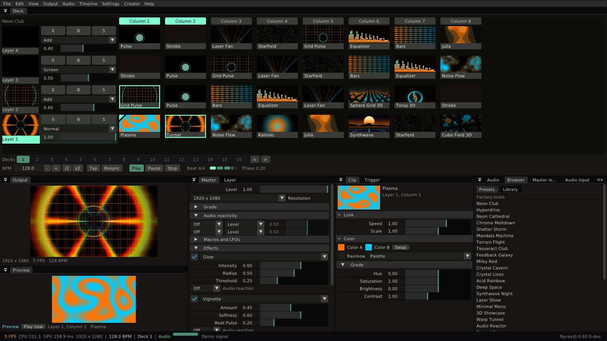
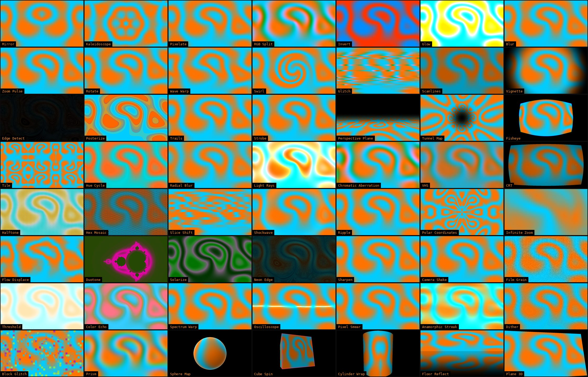

<p align="center">
  
</p>

<h1 align="center">NyrexVJ</h1>

<p align="center">
  Live-Visuals für VRChat-Events und Partys. Natives C++ und OpenGL, keine Game-Engine, je eine Programmdatei für Windows und für Linux.<br>
  <a href="README.md">English</a> · <a href="CHANGELOG.de.md">Änderungsprotokoll</a> · <a href="https://github.com/MarlonXDev/NyrexVJ/releases">Releases</a>
</p>

<p align="center">
  
</p>

NyrexVJ spielt generative Clips auf Ebenen ab, legt Effekte darüber, folgt deiner Musik und schickt das Bild per Spout an OBS oder in ein Vollbild-Ausgabefenster. Das Programm orientiert sich an Resolume Arena und startet trotzdem in einer Sekunde.

> Stand: v0.47.0. Die folgende Liste wurde bei v0.26.0 geschrieben und nennt nicht alles, was seitdem dazugekommen ist; das [Änderungsprotokoll](CHANGELOG.de.md) tut das. Windows- und Linux-Builds, Clips, Effekte, 16 Decks mit weichen Übergängen, Presets, Audio-Reaktivität, Spout- und NDI-Ausgabe, Spout-Eingang, NDI-Eingang und Kameras oder Capture-Karten mit automatischem Wiederverbinden (siehe [docs/LIVE.md](docs/LIVE.md), englisch), bis zu vier Ausgabefenster mit je bis zu acht Ausschnitten, Polygon-Masken, Farbkorrektur, Projection Mapping, Verzerrung, Kantenüberblendung mit Schwarzwert und speicherbare Venue-Setups (siehe [docs/OUTPUTS.md](docs/OUTPUTS.md)), DMX über Art-Net, ein VRSL-Streifen im Video und VRChat-OSC-Parameter (siehe [docs/DMX.md](docs/DMX.md)), eine Beat-Clock, die Tippen, Audio, MIDI-Clock, LTC, MTC oder Pro-DJ-Link-Beats folgt, Timecode-Cues und ein Frame-Lock für die Ausgänge mit Verzögerung und Sync-Balken (siehe [docs/SYNC.md](docs/SYNC.md), englisch), ein Node-Editor, der eigene Effekte aus 68 Nodes baut und als Dateien teilbar macht (siehe [docs/NODES.md](docs/NODES.md), englisch), Plugins, die Modulationsquellen und Bildquellen aus eigenen Bibliotheken hinzufügen und bis zum Einschalten aus bleiben (siehe [docs/PLUGINS.md](docs/PLUGINS.md), englisch), Einstellungsfenster, OSC-Steuerung und OSC-Ausgabe, MIDI-Steuerung, ein 3D-Modell-Player (glTF/GLB) mit realistischer Beleuchtung, der Clip Creator für eigene 3D-Szenen, Bild-Clips mit Transparenz, Video-Clips (H.264, HEVC, AV1, HAP, mit Hardware-Decodierung, Farbumrechnung auf der Grafikkarte, Bildratenbegrenzung und Video-Monitor, braucht die FFmpeg-Bibliotheken, siehe [docs/MEDIA.md](docs/MEDIA.md)) mit Rückwärtswiedergabe, Scrubbing, Start- und Endpunkten, Schleifenmodi, Clip-Tempo, Clip-Länge in Beats und im Hintergrund vorbereiteten nächsten Clips, ein Profiler für Render-Durchläufe, versteckte Ebenen, die nichts kosten, und eine optionale verkleinerte Ebenen-Auflösung (siehe [docs/PERFORMANCE.md](docs/PERFORMANCE.md), englisch), eigene Shader-Clips aus Dateien, Englisch, Deutsch, Spanisch, Französisch und eigene Sprachen ein experimentelles Unreal-Engine-Plugin (nur Quellcode, noch nicht mit Unreal übersetzt) sowie der Auto-Updater funktionieren.

## Download

Lade `NyrexVJ.exe` von der [Release-Seite](https://github.com/MarlonXDev/NyrexVJ/releases) herunter. Es ist eine einzelne Datei, eine Installation ist nicht nötig. Windows SmartScreen kann warnen, weil die Exe nicht signiert ist: "Weitere Informationen" und "Trotzdem ausführen" wählen.

Im Release liegen außerdem `NyrexVJ-windows-x64.zip` (Exe, Changelogs, Readmes) und `SHA256SUMS.txt`.

**Linux:** Lade `NyrexVJ-linux-x64` (eine einzelne Datei, mit `chmod +x NyrexVJ-linux-x64` ausführbar machen) oder `NyrexVJ-linux-x64.tar.gz` (das Programm mit Lizenzen, Changelogs und einer Liste seiner Bibliotheken) von derselben Seite. Es braucht glibc 2.35 oder neuer (Ubuntu 22.04 oder neuer, Debian 12 oder neuer, Fedora, Arch), eine X11- oder XWayland-Sitzung und einen Grafiktreiber mit OpenGL 3.3. Audioaufnahme läuft über PulseAudio oder PipeWire, MIDI über ALSA, Videoclips brauchen die FFmpeg-Bibliotheken. Zum Starten muss nichts installiert werden, jede optionale Bibliothek steht in [docs/DEPENDENCIES.md](docs/DEPENDENCIES.md) (englisch) und die Lizenzen in [THIRD_PARTY_LICENSES.md](THIRD_PARTY_LICENSES.md). Prüfe den Download mit `SHA256SUMS.txt`.

## Highlights

- **16 Decks, weiche Übergänge.** Richte bis zu 16 Looks ein und gleite mit Ausblenden, Auflösen, Zoom, Wischen, Kreis, Rotation oder Schieben dazwischen hin und her, in Sekunden oder Beats, auf Wunsch mit automatischem Wechsel.
- **Audio-reaktiv.** Wähle Systemaudio (dein DJ-Programm), ein Mikrofon, einen Line-In oder ein Demo-Signal. Ebenen, Master und jeder Effektparameter können Bass, Mitten, Höhen, Pegel oder Kick folgen, und ein Effekt lässt sich auf Gate stellen, damit er nur bei lauter Musik sichtbar ist. Acht Makro-Regler und vier tempo-synchrone LFOs funktionieren an denselben Stellen als Quellen.
- **Live-Steuerung.** Spiele es mit einem MIDI-Controller (Regler mit einem Klick anlernen, Windows) oder steuere es per OSC aus TouchDesigner, Max, Python und mehr fern. NyrexVJ kann Tempo, Beats und Audiopegel auch per OSC nach außen schicken. Eine Webseite im Browser (aus per Voreinstellung, siehe [docs/API.md](docs/API.md)) steuert die Show vom selben Computer oder vom Handy aus, und eine REST-API bedient Skripte.
- **Unreal Engine und andere Programme.** Vier Spout-Eingangs-Clips zeigen das Bild von Unreal, TouchDesigner oder einem Spiel (Windows), und die OSC-Ausgabe gibt ihnen Tempo, Beats, Spektrum und eigene benannte Werte. Ein experimentelles Unreal-Engine-Plugin mit Blueprint-Knoten liegt als Quellcode in `integrations/unreal/NyrexVJ`, es wurde noch nie mit der Unreal Engine übersetzt. Siehe [docs/UNREAL.md](docs/UNREAL.md) (englisch).
- **Live-Video.** Vier NDI-Eingangs-Clips und vier Kamera-Clips zeigen das Bild eines anderen Rechners im Netzwerk, einer Webcam oder einer Capture-Karte. NDI-Sender werden automatisch gefunden, eine verlorene Quelle wird von selbst wieder gesucht, das Bild geht als UYVY zur Grafikkarte und wird dort umgerechnet, und eine Quelle kostet nichts, solange keine Ebene sie zeigt. NDI braucht die NDI Tools, Kameras die FFmpeg-Geräte-Bibliothek. Siehe [docs/LIVE.md](docs/LIVE.md) (englisch).
- **Aufnahme.** Das fertige Bild der Show während des Abspielens in eine Videodatei aufnehmen: H.264, HEVC und H.264 auf der Grafikkarte, ProRes, HAP, Motion JPEG, FFV1 oder VP9, bis 3840 x 2160 und 120 Bilder pro Sekunde, mit Ton von deinem Audio-Eingang. Menü Ausgabe, Aufnahme starten, oder `Strg+Umschalt+R`. Die Show wartet nicht auf den Encoder: Bilder, die nicht mehr passen, werden verworfen und gezählt, Dateien überstehen einen Absturz, eine volle Platte beendet die Aufnahme sauber. Braucht die FFmpeg-Bibliotheken, siehe [docs/RECORDING.md](docs/RECORDING.md).
- **Show-Zeitleiste.** Ein optionales Fenster (Menü Zeitleiste, per Voreinstellung aus), das Regler und Schalter mit Keyframes (halten, linear oder weich) neben der Cue-Liste automatisiert, LTC oder MTC folgt oder mit eigener Abspieltaste läuft, Schleifen, Sprünge und einen verlorenen Timecode übersteht, deiner Hand den Vorrang lässt, wenn du einen Regler bewegst, und Rückgängig und Wiederherstellen hat (siehe [docs/TIMELINE.md](docs/TIMELINE.md)).
- **OBS mit zwei Klicks.** Spout-Ausgabe mit frei wählbarem Sendernamen. In OBS die Quelle "Spout2 Capture" hinzufügen und den Sender auswählen.
- **54 Clips, 76 Effekte, 26 Presets.** Fraktale, 3D-Szenen mit Raymarching, Neon-Geometrie, Laser-Netze, Konturlinien-Flüssigkeiten, Kristalltunnel, Blitze, Feuer, Spektrum-Visuals, echte 3D-Modelle und -Szenen und 3D-Effekte wie Image Terrain, Hyperspace, Chrome Liquid, Shatter und Mirror Corridor. Alles, was in einer Version neu ist, trägt ein kleines "neu" hinter dem Namen, bis die nächste Nebenversion kommt.
- **Layout im Resolume-Stil.** Clip-Raster oben, Deck- und Tempozeile darunter, Vorschau und Ausgabe unten links, Master-, Ebenen- und Clip-Fenster daneben und der Browser rechts. Ein Pause-Knopf friert das Bild ein.
- **Zehn Farbthemen.** Einstellungen, Aussehen schaltet die ganze Oberfläche zwischen Studio (Standard: neutrales Dunkel mit rotorangem Akzent, runden Ecken und schlanken Reglern), Orange, Blau, Rot, Grün, Lila, Pink, Cyan, Gold und Mono um.
- **Eigene 3D-Modelle.** Lege .glb- oder .gltf-Dateien in den Modellordner und spiele sie wie jeden Clip, mit Texturen, Animation und Audio-Reaktion.
- **Clip Creator.** Baue eigene 3D-Szenen aus Formen, Modellen und Lichtern, lass alles zur Musik bewegen und speichere sie als tragbare .nyxclip-Dateien.
- **Einstellungsfenster.** Ein Ort für Audio, Ausgabe, Spout, Updates, Sprache und Oberflächengröße, dazu eine Statusleiste mit FPS, Tempo, Deck und Audio auf einen Blick.
- **Eigene Effekte aus Nodes.** Der Node-Editor (Menü Creator, Node-Effekt-Editor) macht aus einem Graphen mit 68 Nodes (Bild, Audio, Beat, LFO, Makros, Mathe, Farbe, Verzerrung, Rauschen, Formen, ein begrenzter Weichzeichner) einen Shader. Das Ergebnis ist ein normaler Effekt mit bis zu vier Reglern, gespeichert als kleine `.nyxfx`-Datei, die du weitergeben kannst. Siehe [docs/NODES.md](docs/NODES.md) (englisch).
- **Plugins.** Ein Plugin ist eine Bibliothek mit einer kleinen C-Schnittstelle. Es fügt Modulationsquellen (eine Zahl von 0 bis 1, etwa 60-mal pro Sekunde) und Bildquellen (1280 x 720, etwa 30 Bilder pro Sekunde) hinzu. Sie erscheinen als `Plugin 1` bis `Plugin 8` neben den Audio-Bändern und als die Clips `Plugin Source 1` bis `Plugin Source 4`. Plugins sind nativer Code ohne Sandbox und bleiben aus, bis du sie einschaltest. Ein Plugin, das zu langsam ist oder ausfällt, wird für die Sitzung abgeschaltet, ohne das Bild anzuhalten, und eines, das das Programm zum Absturz gebracht hat, wird beim nächsten Start nicht wieder geladen. Siehe [docs/PLUGINS.md](docs/PLUGINS.md) (englisch).
- **Eigene Shader-Clips.** Lege eine .glsl-, .frag- oder .fs-Datei (selbst geschrieben oder von Shadertoy) in den Shader-Ordner, und sie wird zum Clip, auf Wunsch mit Transparenz, bis zu vier Feedback-Puffern (Buffer A bis D) und Bildern oder Videos als Eingängen. ISF-Dateien funktionieren auch, als Generatoren und als Bildfilter in der Effektliste, mit Reglern für ihre Eingänge. Siehe [docs/SHADERS.md](docs/SHADERS.md).
- **Englisch, Deutsch, Spanisch und Französisch.** Englisch ist Standard, umschalten jederzeit unter Einstellungen, Allgemein. Eine eigene Sprache kommt über eine kleine .json-Datei dazu, siehe [docs/LANGUAGES.md](docs/LANGUAGES.md).
- **Video zum Spielen.** Jede Video-Zelle hat einen Abspielkopf: scrubben, Bild für Bild schalten, Start- und Endpunkt setzen, Schleife, Ping-Pong oder einmal abspielen, Tempo von -4x bis +4x auch rückwärts oder den Clip auf eine Anzahl Beats legen. Der nächste Clip jeder Ebene wird im Hintergrund vorbereitet, ein Clipwechsel zeigt also kein leeres Bild. Siehe [docs/MEDIA.md](docs/MEDIA.md).
- **DXV-Videos zu HAP, FFmpeg per Knopf.** DXV-Videos (Resolume) brauchen viel Prozessorzeit. NyrexVJ kann im Hintergrund HAP-Kopien davon erstellen (Normal und High Quality, mit und ohne Alpha), mit Fortschritt und Abbrechen-Knopf, in einem Zwischenspeicher, der deine Originaldateien unberührt lässt, und spielt die Kopie über den komprimierten HAP-Weg ab (keine Prozessor-Decodierung, ein Bruchteil des Videospeichers). Der Importmodus ist Aus, Nachfragen (Standard) oder Automatisch. Fehlt FFmpeg, lädt ein Knopf einen fertigen LGPL-Build in den NyrexVJ-Ordner, nachdem Prüfsumme und Lizenz geprüft wurden, nur wenn du ihn drückst und ohne ein bereits installiertes FFmpeg anzufassen. HAP Q mit Transparenz wird nicht unterstützt. Siehe [docs/MEDIA.md](docs/MEDIA.md) und [docs/FFMPEG.md](docs/FFMPEG.md).
- **Schonend für die Grafikkarte.** Ebenen mit Deckkraft null werden nicht gezeichnet, eine optionale Ebenen-Auflösung (Voll, Ausgewogen, Leistung oder Automatisch) tauscht Pixel gegen Bildzeit, ungenutzte Bilder werden freigegeben, und Einstellungen, Leistung zeigt, welcher Clip oder Effekt die Zeit braucht. Gemessene Zahlen und Grenzen stehen in [docs/PERFORMANCE.md](docs/PERFORMANCE.md) (englisch).
- **Willkommensbildschirm.** Beim ersten Start und nach jedem Update, mit allem, was neu ist.
- **Aktualisiert sich selbst.** Prüft GitHub beim Start, kontrolliert die SHA-256-Summe und zeigt oben rechts eine kleine Karte mit Jetzt neu starten oder Später.

<p align="center">
  
</p>

<p align="center">
  
</p>

## Handbuch

NyrexVJ hat ein vollständiges Handbuch: 36 Kapitel dazu, wie alles funktioniert und wo man es findet, vom ersten Start bis zu Shows, Ausgängen und Fehlersuche. Es ist Teil des Programms: **Hilfe, Handbuch** oder `F1` öffnet ein Fenster mit Inhaltsverzeichnis, Suche, Links zwischen den Kapiteln und einer Zurück-Taste, auch ohne Internet. Derselbe Text mit Bildern steht auf der Webseite (`site/de/handbuch/`, englisch `site/manual/`).

Das Handbuch gibt es auf Englisch und Deutsch. Steht die Oberfläche auf Deutsch, siehst du das deutsche Handbuch, bei jeder anderen Sprache das englische. Die Quelle ist `docs/manual/`, wie es gebaut und geprüft wird steht in [docs/MANUAL.md](docs/MANUAL.md) und die Webseite in [docs/WEBSITE.md](docs/WEBSITE.md).

## Live-Workflow

Das Menü Quantisierung in der Transportleiste (Aus, Beat, Takt, 2 Takte, 4 Takte) lässt Start von Clips, Spalten und Decks auf die Beat-Uhr warten, egal ob er von der Maus, der Tastatur, MIDI, OSC, der Weboberfläche, Cues oder der Zeitleiste kommt; es ist per Voreinstellung aus und startet sofort, wenn es keine brauchbare Beat-Uhr gibt. In der Bibliothek kannst du mit Rechtsklick einen Clip als Favorit markieren, ihm Tags geben oder ihn in jeder Zelle jedes Decks in einem rückgängig machbaren Schritt ersetzen, und mit `tag:name` und `is:fav` suchen. In Einstellungen, Steuerung kannst du MIDI-Rückmeldung an einen Controller senden (leuchtende Pads, bewegte Fader, vorerst nur unter Windows) und benannte Controller-Profile speichern und laden. Einzelheiten: [docs/WORKFLOW.md](docs/WORKFLOW.md) (englisch).

## Decks

Die Zeile über dem Clip-Raster enthält 16 Deck-Knöpfe. Jedes Deck ist ein vollständiger Satz aus vier Ebenen, acht Spalten, Effekten und Farben. Ein Klick auf einen Knopf wechselt das Deck, das neue Deck übernimmt mit einem Übergang statt eines Schnitts. Das aktuelle Deck ist orange, leere Decks sind gedimmt und starten leer, wenn du sie anklickst.

| Übergang | Aussehen |
| --- | --- |
| Ausblenden | Weiche Überblendung |
| Auflösen | Verrauschtes Durchbrennen mit leuchtender Kante |
| Zoom | Zieht durch das alte Bild ins neue |
| Wischen | Weicher diagonaler Wisch |
| Kreis | Kreis, der sich aus der Mitte öffnet |
| Rotation | Beide Bilder drehen sich ineinander |
| Schieben | Neues Deck schiebt sich von der Seite herein |

Stelle die Dauer in Sekunden ein oder hake Beat-Sync an, um in Beats zu zählen, und hake Auto-Wechsel an, um alle 4 bis 128 Beats durch die benutzten Decks zu schalten. Wechselst du mitten im Übergang erneut, friert das aktuell sichtbare Bild ein und blendet von dort aus weiter, es gibt also nie einen Sprung.

Rechtsklick auf einen Deck-Knopf: umbenennen, aktuelles Deck hierher kopieren, mit einem Werks-Look füllen, leeren oder entfernen. Im Presets-Tab lädt ein Klick auf einen Werks-Look ihn ins aktuelle Deck, und "Decks mit Werks-Looks füllen" legt 16 Looks in die 16 Decks. Decks werden mit dem Preset und mit der Sitzung gespeichert.

## Audio

Öffne den Audio-Tab im Browser-Panel oder Einstellungen, Audio.

| Quelle | Worauf gehört wird |
| --- | --- |
| Ausgabegeräte (Loopback) | Alles, was dein PC abspielt, zum Beispiel Rekordbox, Serato, Spotify oder ein Browser. Unter Linux ist das "System audio (default output)" und jede Monitor-Quelle von PulseAudio oder PipeWire |
| Eingabegeräte | Mikrofon oder Line-In. Unter Linux "Default input" und jede andere Quelle von PulseAudio oder PipeWire |
| Demo-Signal | Ein eingebauter Beat, damit du ohne Musik Looks bauen kannst |

Der Tab zeigt das Live-Spektrum, Bass-, Mitten-, Höhen- und Pegelanzeigen, Beat-Erkennung und eine Tempo-Schätzung. Verstärkung, Glättung und Beat-Schwelle sind in Einstellungen, Audio einstellbar, und "BPM mit Audio synchronisieren" koppelt das Tempo an den erkannten Beat. Liefert das gewählte Gerät mehrere Sekunden lang keinen Ton, weisen der Tab und die Statusleiste darauf hin.

<p align="center">
  
</p>

Die Reaktivität stellst du an drei Stellen ein:

- **Ebenen-Panel**: zwei Modulationsplätze pro Ebene (Band auf Deckkraft, Skalierung, Geschwindigkeit, Farbton, Helligkeit oder Sättigung, mit einer Stärke).
- **Master-Panel**: dasselbe für das fertige Bild.
- **Jeder Effektplatz**: ein Band und ein Modus. Im Modus Parameter bewegt das Band einen Effektwert um eine Stärke. Im Modus Gate ist der Effekt nur sichtbar, solange das Band laut ist, und blendet in der Stille aus, die Stärke bestimmt die Empfindlichkeit.

Bars, Equalizer, Spectrum Circle, Oscilloscope, Spectrum Warp und der Effekt Oscilloscope zeichnen das echte Spektrum oder die Wellenform. Ohne Audioquelle laufen sie auf einem virtuellen Beat, der dem BPM folgt.

## Makros, LFOs und Beat-Raster

Jede Stelle, die Bass, Mitten, Höhen, Pegel oder Kick folgen kann (die zwei Slots einer Ebene, der Master und jeder Effekt-Slot), kann drei weiteren Quellen folgen:

- **Makro 1 bis 8**: Regler im Master-Bereich unter Makros und LFOs. Ein Makro kann viele Parameter gleichzeitig steuern, und jeder Regler lässt sich auf einen MIDI-Controller legen (Einstellungen, Steuerung) oder per OSC setzen (`/nyrex/macro/1` bis `/nyrex/macro/8`).
- **LFO 1 bis 4**: tempo-synchrone Oszillatoren mit den Formen Sinus, Dreieck, Sägezahn, Rechteck, Zufall und Weicher Zufall. Der Zyklus reicht von einem Viertel-Schlag bis zu 32 Schlägen, die Phase bestimmt, wo im Zyklus der LFO startet. Weil sie Schläge zählen, nehmen Tap, Neu sync, Pause und die BPM sie mit, und ein Verlauf läuft nie aus dem Takt.
- **Beat und Takt**: eine Rampe von 0 auf 1 über einen Schlag bzw. einen Takt.

Ein Klick auf die Beat-Anzeige neben den Tempo-Reglern öffnet das Beat-Raster: Schläge pro Takt einstellen (2 bis 8), das Raster mit `<<` und `>>` um einen Sechzehntel-Schlag verschieben, auf den nächsten Schlag einrasten oder den nächsten Schlag zum ersten Schlag des Takts machen. Die Einzelheiten und die Reihenfolge der Quellen stehen in [docs/MODULATION.md](docs/MODULATION.md) (englisch).

## Spout und OBS

1. In NyrexVJ unter Einstellungen, Ausgabe (oder im Menü Ausgabe) "Per Spout an OBS senden" anhaken und einen Sendernamen wählen.
2. In OBS einmalig das [obs-spout2-plugin](https://github.com/Off-World-Live/obs-spout2-plugin) installieren.
3. Eine Quelle "Spout2 Capture" hinzufügen und den Sender aus der Liste wählen.

Spout gibt es nur unter Windows. Das Ausgabefenster (F11) mit OBS-Fensteraufnahme funktioniert weiterhin als Alternative.

### Spout-Eingang

Vier Clips, Spout Input 1 bis 4 (Bibliotheksfilter Spout), zeigen das Bild, das ein anderes Programm per Spout sendet. Lege einen in eine Zelle, wähle ihn aus und such den Sender im Clip-Fenster aus, oder lass ihn auf Automatisch, dann gilt der erste Sender, der nicht NyrexVJs eigene Ausgabe ist. Das Bild wird ohne Verzerrung in die Ebene eingepasst, läuft wie jeder Clip durch die Ebenen-Effekte, verbindet sich wieder, wenn der Sender zurückkommt, und zeigt einen Platzhalter, solange keiner da ist. Kommt das Bild kopfüber an, hake Bild vertikal spiegeln an. Die gewählten Sender stehen in den Programmeinstellungen. Nur Windows, auf anderen Systemen fügt `--spout-test-pattern` einen Test-Sender zum Ausprobieren hinzu. Einzelheiten und die Einrichtung mit Unreal Engine stehen in [docs/UNREAL.md](docs/UNREAL.md) (englisch).

### Live-Quellen

Acht Clips zeigen ein Live-Bild: NDI Input 1 bis 4 (das Bild eines anderen Programms oder Rechners im Netzwerk) und Camera 1 bis 4 (eine Webcam oder eine Capture-Karte), Bibliotheksfilter Live. Lege einen in eine Zelle, wähle ihn aus und such die Quelle im Clip-Fenster aus. NDI-Sender werden automatisch aufgelistet, Automatisch nimmt den ersten Sender, der nicht NyrexVJs eigene Ausgabe ist. Kameras stehen in einer Liste mit Aktualisieren-Knopf, Auflösung und Bildrate sind eine Anfrage, die das Gerät mit seinem nächsten Modus beantwortet. Das Clip-Fenster zeigt den Zustand (Suche, Verbinde, Live, Signal verloren, Verbinde neu), die Größe, die Bildrate, verworfene Bilder und die Latenz vom Eintreffen bis zum Ende des Uploads. Eine verlorene Quelle wird von selbst wieder gesucht (0,5 Sekunden, dann doppelt so lang bis 10 Sekunden); das letzte Bild bleibt solange auf der Ebene. Eine Quelle wird geöffnet, wenn eine Ebene ihren Clip zeigt, und drei Sekunden nach der letzten Nutzung geschlossen, sie kostet also nichts, solange sie ungenutzt ist. NDI braucht die NDI-Runtime, die nicht mitgeliefert wird (installiere die kostenlosen NDI Tools); Kameras brauchen die FFmpeg-Bibliotheken samt Geräte-Bibliothek. Alles, die gemessenen Zahlen und was nicht getestet ist (noch keine echte Kamera, Capture-Karte oder NDI-Runtime), steht in [docs/LIVE.md](docs/LIVE.md) (englisch).

## Ausgänge, Mapping und NDI

Einstellungen, Ausgabe hat für jedes der bis zu vier Ausgabefenster einen Reiter. Jeder Ausgang hat einen eigenen Bildschirm und bis zu acht Ausschnitte, jeder mit eigenem Bildausschnitt, Eckpunkten, einem Verzerrungsraster bis 17 x 17 (in der Live-Fläche ziehen), Kantenüberblendung mit Schwarzwert, Helligkeit, einer Maske mit weicher Kante (ein Polygon mit auf Wunsch gebogenen Kanten, eine mit der Maus frei gezeichnete Form oder ein Bild wie eine PNG-Datei) und einem Testbild, dazu eine Farbkorrektur je Ausschnitt und eine für den ganzen Ausgang (Verstärkung je Kanal, Sättigung, Kontrast, Gamma, Schwarzanhebung) und auf Wunsch eine eigene NDI-Quelle, die den Ausgang genau so zeigt, wie das Fenster ihn zeigt (mit Masken, Verzerrung und Farbe). Ausgänge anordnen richtet ein Raster aus überlappenden Projektoren mit einem Klick ein. Die Ausgänge lassen sich als Venue-Setup speichern, eine kleine JSON-Datei je Spielort, die man laden, duplizieren, exportieren, importieren (auch durch Ziehen der Datei auf das Fenster) oder beim Start mit `--venue` laden kann. NDI sendet das Hauptbild und auf Wunsch jeden Ausgang über das Netzwerk an OBS, Resolume oder vMix; die NDI-Bibliothek wird nicht mitgeliefert, installiere die kostenlosen NDI Tools. Für Masken, Verzögerung und das Auslesen für NDI wird ein Speicherbudget von 384 MiB geführt. Alles steht in [docs/OUTPUTS.md](docs/OUTPUTS.md) (englisch), auch was getestet ist und was nicht (noch keine echten Projektoren, kein Mehrmonitor-Aufbau und keine echte NDI-Runtime).

## Show-Sync

Eine Beat-Clock steuert alles, was dem Beat folgt. Einstellungen, Sync wählt ihre Quelle: Automatisch (die beste vorhandene Quelle in dieser Reihenfolge: Pro DJ Link, Timecode, MIDI-Clock, Audio, manuell) oder eine feste Quelle. Die Clock gleicht einen Phasenfehler schrittweise aus, damit ein Bild im Beat nicht ruckelt, und zeigt die aktive Quelle, einen Einrast-Zustand (Freilaufend, Suche, Erfassen, Eingerastet, Verloren), den Phasenfehler in Millisekunden und einen Latenzausgleich von -500 bis +500 ms. Timecode kommt als LTC von einem eigenen Audioeingang (24, 25, 29,97 Drop-Frame und 30 Bilder pro Sekunde) oder als MTC über MIDI und steuert die Clock-Position, zwei Modulationsquellen (Timecode-Sekunde und -Minute) und eine Cue-Liste, die zu einer Zeit ein beliebiges Steuerziel auslöst. MIDI-Clock, Start, Stopp und Song Position werden verfolgt, und die Beat-Pakete von Pro DJ Link verfolgt ein passiver Zuhörer, der sich nie im Netzwerk meldet und nichts sendet (kein Abspielstatus, kein Master-Flag). StageLinq wurde geprüft und nicht eingebaut, die Gründe stehen im Dokument. Einstellungen, Ausgang, Frame-Lock zeichnet zuerst alle Ausgabefenster und tauscht sie direkt nacheinander, kann jeden Ausgang um 0 bis 8 Bilder verzögern, zeigt den gemessenen Tausch-Versatz und hat ein Sync-Balken-Muster, um mehrere Bildschirme zu filmen. Es ist kein Hardware-Genlock. Alles, die Zahlen und die lange Liste dessen, was nicht getestet wurde (keine echten Player, Mixer, Timecode-Generatoren oder Beamer), steht in [docs/SYNC.md](docs/SYNC.md) (englisch).

## Show-Zeitleiste

Menü Zeitleiste, Zeitleiste ausführen schaltet die Zeitleiste ein (per Voreinstellung ist sie aus), Fenster der Show-Zeitleiste anzeigen öffnet sie. Mit *Spur hinzufügen* legst du eine Spur für einen beliebigen Regler oder Schalter an, ein Doppelklick auf eine Spur setzt Keyframes, du ziehst sie, und ein Rechtsklick auf einen Keyframe wählt halten, linear oder weich. Die Cue-Liste aus Einstellungen, Sync ist auf demselben Lineal zu sehen, ihre Cues lassen sich dort verschieben und hinzufügen. Die Position folgt einem Timecode, wenn einer da ist, und läuft sonst mit Abspielen, Pause und Stopp des Fensters; Umschalt und Ziehen auf dem Lineal markiert eine Schleife. Bewegst du einen gesteuerten Regler von Hand, lässt die Zeitleiste ihn los (bis zum nächsten Keyframe-Abschnitt oder bis du ihn freigibst). Die Spuren stehen in `timeline.json`, getrennt von Presets und von `cues.json`. Clips, Spalten und Decks sind Auslöser und gehören auf die Cue-Spur; die Regler von Shader-Clips lassen sich noch nicht automatisieren. Einzelheiten, Grenzen und was nicht getestet wurde steht in [docs/TIMELINE.md](docs/TIMELINE.md).

## Node-Effekte

Creator, Node-Effekt-Editor öffnet einen Graph-Editor. Rechtsklick fügt einen Node hinzu, Ziehen von einem Pin zum nächsten verbindet, und der Effekt wird kurz nach jeder Änderung gespeichert und neu gebaut. Die Statuszeile zeigt, ob er kompiliert, wie oft er das Bild liest (höchstens 64) und die Meldung am fehlerhaften Node; eine ungültige Änderung lässt den letzten guten Shader weiterlaufen. Nodes lesen das Bild, die Audio-Analyse, den Beat, acht Makros und vier Regler, und ein LFO läuft im Shader auf der Beat-Clock. Ein Graph wird zu einem einzigen Shader übersetzt, ein Node-Effekt kostet also so viel wie derselbe Effekt von Hand geschrieben: In einem Test gegen vier handgeschriebene Effekte lagen die Effektzeiten im Rahmen der Streuung der Läufe gleich, und die drei Effekte ohne Rückkopplung ergaben identische Bilder. Effekte sind `.nyxfx`-Dateien im Ordner `nodes` des Nutzerdatenordners und stehen in der Bibliothek als `Node: <Name>`; zum Importieren eine Datei auf das Fenster ziehen. Vier Beispiele lassen sich mit einem Knopf anlegen. Es gibt keinen Zoom, und der Editor wurde nur per Skript bedient, die Liste dessen, was nicht getestet wurde, steht in [docs/NODES.md](docs/NODES.md) (englisch).

## Plugins

Einstellungen, Plugins listet die Plugin-Ordner auf, die im Ordner `plugins` des Benutzerdatenordners liegen. **Ein Plugin ist nativer Code und läuft mit denselben Rechten wie NyrexVJ. Es gibt keine Sandbox. Schalte nur Plugins aus Quellen ein, denen du vertraust.** Plugins sind aus, bis du sie anhakst, und `--no-plugins` schaltet sie für einen Start aus. Eine Plugin-Quelle wählst du für `Plugin 1` bis `Plugin 8` (eine Modulationsquelle, die in jeder Quellenliste benutzbar ist) oder für einen von vier Bild-Plätzen (die Clips `Plugin Source 1` bis `Plugin Source 4`), und jede Quelle hat bis zu vier Parameter. Plugin-Code läuft nie auf dem Render-Thread: Jeder Aufruf hat ein Zeitbudget, ein Plugin, das zu langsam ist, hängt oder fehlschlägt, wird für die Sitzung abgeschaltet, und ein Plugin, das beim Absturz des Programms lief, kommt in den sicheren Modus und bleibt aus, bis du es wieder einschaltest. Plugin-Bänder gibt es in der Bühne nicht. Eine C-Header-Datei (API 1.1, für jede 1.x-Version stabil), ein Beispiel-Plugin und die vollständige Referenz stehen in [docs/PLUGINS.md](docs/PLUGINS.md) (englisch), die Gründe in [ADR 0018](docs/adr/0018-plugin-system.md) und [ADR 0026](docs/adr/0026-plugin-system-2.md), das auch bewertet, Plugins in einem eigenen Prozess laufen zu lassen (nicht gebaut).

## Bühnensteuerung: DMX, VRSL-Streifen und VRChat

Einstellungen, Bühne macht aus jedem Regler DMX. Jeder Kanal folgt einem festen Wert oder einer Modulationsquelle (Audioband, LFO, Makro, Beat, Takt). Die Kanäle gehen als Art-Net hinaus (für HNode, QLC+ oder ein Lichtpult), lassen sich für VRSL als Streifen aus 120 x 13 Blöcken ins Ausgabevideo zeichnen, und VRChat-Avatar-Parameter werden per OSC gesendet. Testmuster helfen beim Prüfen des Aufbaus. Die Zuordnung von Kanal zu Block im Streifen folgt der öffentlichen VRSL-Beschreibung, ist aber noch nicht an einer echten VRSL-Welt geprüft, und mit echten Art-Net-Geräten oder VRChat wurde noch nichts ausprobiert, siehe [docs/DMX.md](docs/DMX.md).

## Clips und Effekte

<p align="center">
  
</p>

Jede Ebene hat vier Effektplätze, der Master ebenfalls.

<p align="center">
  
</p>

Die Effekt-Galerie zeigt jeden Effekt mit Standardwerten auf dem Clip Plasma (Duotone auf Mandelbrot und Line Art auf Crystal Cavern, weil Plasma kaum Helligkeitskontrast hat). Clip- und Effektnamen bleiben englisch, damit sie zu anderen VJ-Programmen passen.

## Eigene Shader-Clips

Jeder Fragment-Shader kann ein Clip werden. Lege eine `.glsl`-, `.frag`- oder `.fs`-Datei in den Shader-Ordner (Bibliothek, Shader-Ordner öffnen, oder ziehe die Datei auf das Fenster), dann erscheint sie in der Bibliothek als `Shader: Dateiname`, Filter Shader. Sie funktioniert wie jeder andere Clip: Geschwindigkeit, Größe, Farben, Effekte, Audio, LFOs und Makros wirken alle. Eine gespeicherte Änderung lädt sie neu, während sie läuft, und ein Kompilierfehler erscheint im Clip-Fenster mit der Zeilennummer deiner Datei. Eine Zeile `#pragma nyrexvj alpha` macht den Clip transparent, und Abschnitte (`buffer a` bis `d`, `image`, `channel`) machen die Datei zu einem Multipass-Shader mit Feedback; Dateien ohne eine solche Zeile verhalten sich genau wie bisher. Bibliothek, Beispiel-Shader erstellen schreibt einen kleinen Shader zum Loslegen. NyrexVJ-Stil (`void main()`) und Shadertoy-Stil (`mainImage`) werden automatisch erkannt, die Uniforms, Hilfsfunktionen und Grenzen stehen in [docs/SHADERS.md](docs/SHADERS.md). ISF-Dateien (ein Kopf `/*{ ... }*/`, das Format von VDMX und anderen) werden aus demselben Ordner gelesen: Eine Datei mit einem Eingang `inputImage` wird zu einem Effekt namens `ISF: Dateiname`, jede andere wird zu einem Clip, und die Eingänge erscheinen als Regler im Clip-Fenster (oder als die vier Regler des Effekts). Was eine ISF-Datei nicht kann (Vertex-Shader, Übergänge, Audio-Eingänge und mehr), steht im Clip-Fenster und in [docs/SHADERS.md](docs/SHADERS.md). Sieben Beispiele, zwei für den NyrexVJ- und den Shadertoy-Stil und fünf für ISF, liegen in `docs/shaders/`.

## 3D-Modelle

Neben den Shader-Clips gibt es Clips, die echte 3D-Gitter zeichnen: Torus Knot Mesh, Crystal Cluster Mesh, Orbit Rings Mesh, Chrome Orbs Mesh, Neon Cubes Mesh, Gold Knot Mesh und Pulse Columns Mesh. Sie stehen im Bibliothek-Tab wie jeder andere Clip, folgen Farben, Tempo und Größe der Ebene, pulsieren mit Bass und Kick und laufen durch dieselben Effekte.

Um ein eigenes Modell zu spielen, lege eine `.glb`- oder `.gltf`-Datei in den Modellordner (`%APPDATA%\NyrexVJ\models`, der Bibliothek-Tab zeigt den Pfad und hat einen Knopf, der ihn öffnet) und drücke im Bibliothek-Tab Neu einlesen (ein Neustart ist nicht nötig). Sie erscheint als `Model: Dateiname`. Unterstützt werden Texturen (PNG und JPEG), Knoten-Animation, Charaktere mit Skelett (Skelett-Animation), Morph-Targets (Blend Shapes) und mehrere Gitter. Ein Modell lädt im Hintergrund, sobald ein Deck es zum ersten Mal enthält, das Bild bleibt also nie stehen, mit einem Zeitlimit von 60 Sekunden und einem Knopf Laden abbrechen, und eine beschädigte, zu große oder nicht unterstützte Datei wird mit einer Meldung im Log und im Clip-Tooltip abgelehnt. Ebenen, die dasselbe Modell spielen, teilen es sich im Speicher.

Modelle mit Metallic-Roughness-Materialien, Normalenkarten, Leuchtkarten und ausgeschnittener Transparenz werden mit physikalisch basierter Beleuchtung gezeichnet. Weiche Transparenz (`alphaMode` `BLEND`) wird pro Gitter von hinten nach vorn sortiert. Mit Meshopt komprimierte Dateien werden standardmäßig gelesen, Draco-Dateien nur in einem Build mit `-DNYREXVJ_DRACO=ON` (sonst werden sie mit einer Meldung abgelehnt, die die Option nennt). Lichter und Kameras in einer Datei werden gezählt, aber nicht benutzt, die Szene behält ihre eigenen. Grenzen schützen den Grafikspeicher (128 Gelenke pro Skelett, 32 Morph-Targets, 640 MiB pro Szene). Noch nicht unterstützt: Tangenten und ein zweiter UV-Satz, Textur-Transformationen und Material-Erweiterungen außer der Leuchtstärke. Alle Grenzen und die Messwerte stehen in [docs/SCENE3D.md](docs/SCENE3D.md).

### Clip Creator

Das Menü Creator öffnet den Clip Creator. Die linke Spalte listet die Objekte und Lichter der Szene, die Mitte zeigt eine Live-Vorschau (Ziehen kreist, Mausrad zoomt, Diese Ansicht als Clip-Kamera nehmen behält die Ansicht), die rechte Spalte ist der Inspektor für Transformation, Wiederholung, Material, Texturen, Animation, Audio-Reaktionen, Kameras, Himmel und Belichtung. Eine Szene kann bis zu acht Kameras haben: Wähle die, die läuft, oder lass den Clip alle paar Beats zwischen allen schneiden. Starte mit einer Vorlage (Menü Creator, Mit einer Vorlage starten, oder Öffnen im Fenster) oder mit einer leeren Szene (Neu).

Speichern schreibt eine `.nyxclip`-Datei in den Clips-Ordner (`%APPDATA%\NyrexVJ\clips`). Sie enthält die Szenenbeschreibung und als Kopien die .glb-Modelle sowie PNG- oder JPEG-Texturen, die die Szene benutzt (bis 200 MiB), eine Datei genügt also zum Weitergeben. Danach erscheint sie in der Bibliothek unter Szenen als `Scene: Name`. Als Clip nutzen legt sie außerdem in die gewählte Zelle. In einer Szene lassen sich nur `.glb`-Modelle speichern, `.gltf`-Dateien, die weitere Dateien brauchen, stehen in der Dateien-Ansicht, sind aber nicht nutzbar. Das Dateiformat und die Entscheidungen dahinter stehen in [docs/adr/0004-scene-document-and-clip-pack.md](docs/adr/0004-scene-document-and-clip-pack.md), das Beleuchtungsmodell in [docs/adr/0005-pbr-shading.md](docs/adr/0005-pbr-shading.md) und der Editor in [docs/adr/0006-clip-creator.md](docs/adr/0006-clip-creator.md).

## Presets

18 fertige Looks: Neon Club, Milky Red, Crystal Cavern, Crystal Lines, Acid Rainbow, Deep Space, Synthwave Night, Laser Show, Minimal Mono, 3D Showcase, Warp Tunnel, Audio Reactor, Fractal Dream, Cyber Rain, Inferno, 3D Worlds, Crystal Cube und Pop Art. Eigene Looks speicherst du im Presets-Tab, ein gespeichertes Preset enthält alle 16 Decks. Die letzte Sitzung wird beim Start wiederhergestellt. Datei, Show-Paket exportieren packt die aktuelle Show und alle Dateien, die sie nutzt, in eine `.nyxshow`-Datei, die du auf einen anderen Computer kopieren kannst, und Datei, Show-Paket importieren (oder die Datei auf das Fenster ziehen) zeigt, was passieren würde, bevor etwas geändert wird, lässt deine eigenen Dateien in Ruhe, solange du nichts anderes wählst, und stellt alles wieder her, wenn etwas fehlschlägt; Plugins sind nie Teil eines Pakets. Einzelheiten: [docs/SHOWS.md](docs/SHOWS.md) (englisch). Datei, Community-Paket installieren öffnet eine `.nyxpack`-Datei von jemand anderem (Presets, Shader, Node-Effekte, Masken, Venue-Setups und manchmal ein Plugin) mit versionierter Dateiliste, Lizenz, Abhängigkeiten und den passenden NyrexVJ-Versionen: Du siehst zuerst einen Plan, deine eigenen Dateien werden nie ohne Nachfrage ersetzt, ein Plugin braucht deine Zustimmung und bleibt ausgeschaltet, und Updates und Entfernen verschieben Dateien in eine Sicherung. Einzelheiten: [docs/PACKAGES.md](docs/PACKAGES.md) (englisch). Creator, Text und Partikel... macht Text-Clips (eigene Schrift, Unicode, Ausrichtung, acht Animationen, durchsichtiger Hintergrund) und Partikel-Clips (begrenzte Partikelzahl, Stöße auf dem Beat, die Musiklautstärke als Modulation), die wie jeder andere Clip spielen, und Creator, Effektketten... speichert die vier Effekte einer Ebene als Kette, die du suchen, ansehen, anwenden, exportieren und importieren kannst. Einzelheiten und Grenzen: [docs/GENERATORS.md](docs/GENERATORS.md) (englisch).

## Bedienung

| Eingabe | Aktion |
| --- | --- |
| Klick auf eine Zelle | Clip auf seiner Ebene abspielen |
| Klick auf einen Spaltenkopf oder Tasten 1 bis 8 | Ganze Spalte auslösen |
| Leertaste | Tap Tempo |
| Bild auf / Bild ab | Vorheriges / nächstes benutztes Deck |
| Strg + 1 bis 8, Strg + Umschalt + 1 bis 8 | Deck 1 bis 8, Deck 9 bis 16 |
| Strg + , | Einstellungen öffnen |
| B | Blackout |
| F11 | Vollbild-Ausgabefenster |
| Esc | Vollbild verlassen |
| Rechtsklick auf eine Zelle | Clip zuweisen oder entfernen |
| Rechtsklick auf einen Deck-Knopf | Deck umbenennen, kopieren, füllen, leeren oder entfernen |
| Rechtsklick auf einen Regler | Auf Standardwert zurücksetzen |
| Clip in der Bibliothek anklicken | In die gewählte Zelle legen und abspielen |
| Aus der Bibliothek auf eine Zelle oder einen Spaltenkopf ziehen | Clip zuweisen |
| Effekt in der Bibliothek anklicken oder ziehen | Zum gewählten Layer hinzufügen |
| B / S / X an einer Ebene | Bypass / Solo / Ebene stoppen |

## Live-Steuerung

Alles liegt unter Einstellungen, Steuerung. Zuordnungen und Adressen beziehen sich auf das aktuelle Deck, also das, das du im Clip-Raster siehst.

### MIDI

Unter Windows und Linux (unter Linux muss der Controller als ALSA-Sequencer-Port erscheinen, `aconnect -l` listet sie auf). Wähle deinen Controller unter Gerät, drücke Zuordnung hinzufügen, wähle was gesteuert werden soll und bewege dann einen Regler oder drücke eine Taste am Controller. Ab dann sind beide verbunden. Regler und Fader (CC) setzen Werte, Tasten (Noten) lösen Auslöser aus oder schalten Dinge ein, solange sie gehalten werden. Mit Invertieren drehst du einen Fader um, mit Lernen bekommt eine Zeile einen neuen Regler und mit Entfernen löschst du sie. Die Zuordnungen stehen in `controls.json` im Datenordner. Ein Controller, den ein anderes Programm exklusiv geöffnet hat, lässt sich nicht von zwei Programmen gleichzeitig nutzen.

### OSC

Hake OSC-Nachrichten empfangen an. OSC ist standardmäßig aus und lauscht auf Port 9010 (VRChat nutzt 9000, so kommen sich beide nicht in die Quere). Nur dieser Computer darf senden, außer du hakst Nachrichten von anderen Computern annehmen an, dann kann jeder in deinem Netzwerk NyrexVJ steuern. Sende eine Zahl an eine Adresse. Float, Integer und true oder false werden akzeptiert und als 0 bis 1 gelesen. Eine Nachricht ohne Wert feuert einen Auslöser oder schaltet einen Schalter um. Die Einstellungsseite listet jede Adresse, ein Klick kopiert sie.

| Adresse | Bedeutung |
| --- | --- |
| `/nyrex/master/level` | Master-Pegel, 0 bis 1 |
| `/nyrex/master/blackout` | Blackout, an ab 0,5 |
| `/nyrex/master/bpm` | Tempo, 0 bis 1 entspricht 40 bis 240 BPM |
| `/nyrex/master/tap`, `/nyrex/master/resync` | Tap-Tempo, Beat neu starten |
| `/nyrex/master/hue`, `saturation`, `brightness`, `contrast` | Master-Farbe, 0 bis 1 über den üblichen Bereich |
| `/nyrex/deck/1` bis `/nyrex/deck/16` | Zu diesem Deck wechseln |
| `/nyrex/deck/next`, `/nyrex/deck/previous` | Nächstes oder vorheriges benutztes Deck |
| `/nyrex/column/1` bis `/nyrex/column/8` | Spalte auslösen |
| `/nyrex/layer/L/clip/C` | Clip der Ebene L in Spalte C auslösen |
| `/nyrex/layer/L/opacity`, `speed`, `scale` | Ebenenwerte, Tempo 0,1 bis 4 und Größe 0,25 bis 4 |
| `/nyrex/layer/L/hue`, `saturation`, `brightness`, `contrast` | Ebenenfarbe |
| `/nyrex/layer/L/bypass`, `solo` | Ebenenschalter |
| `/nyrex/layer/L/clear` | Ebene stoppen |
| `/nyrex/layer/L/fx/S/enable` | Effektplatz S an oder aus |
| `/nyrex/layer/L/fx/S/param/P` | Parameter P des Effekts in Platz S |
| `/nyrex/master/fx/S/enable`, `/nyrex/master/fx/S/param/P` | Dasselbe für die Master-Effekte |

Ebenen gehen von 1 bis 4, Effektplätze von 1 bis 4 und Parameter von 1 bis 4. Ein schneller Test mit Python und dem Paket `python-osc`: `SimpleUDPClient("127.0.0.1", 9010).send_message("/nyrex/master/level", 0.5)`.

### OSC-Ausgabe

Einstellungen, Steuerung, OSC-Ausgabe, OSC-Daten senden anhaken. NyrexVJ sendet dann an `127.0.0.1` Port 9011, 60 Mal pro Sekunde (Adresse, Port und Rate lassen sich ändern, erlaubt sind nur IPv4-Adressen und `localhost`). Alles beginnt mit `/nyrex/out/`: `hello` (alle 2 s, mit der Schemanummer 1), `audio` (Bass, Mitten, Höhen, Pegel, Kick), `spectrum` (32 Bänder), `clock` (BPM, Beat-Nummer, Position im Beat), `beat` und `onset` (Ereignisse) sowie `param/<Name>` für bis zu 16 eigene Werte, die jeweils einem Regler wie `layer/1/opacity` folgen. Die vollständige Tabelle, die Versionsregeln und die Einrichtung mit Unreal Engine stehen in [docs/UNREAL.md](docs/UNREAL.md) und [ADR 0008](docs/adr/0008-osc-output-protocol.md) (beide englisch).

### Weboberfläche

Einstellungen, Steuerung, Web-Oberfläche, Web-Oberfläche einschalten anhaken, dann Web-Oberfläche öffnen anklicken. NyrexVJ startet einen kleinen Webserver auf `127.0.0.1` Port 9020 (änderbar) und öffnet im Browser eine Seite, mit der du die Show steuerst: Status, Master-Pegel, Blackout, Tap-Tempo, die 16 Decks, die Spalten-Trigger, das Clip-Raster aller vier Ebenen mit Deckkraft, Bypass, Solo und Leeren, die Werks-Looks und deine eigenen Looks sowie die Ausgänge. Sie ist aus, bis du sie einschaltest, und nur dieser Computer erreicht sie, es sei denn, du hakst auch Andere Geräte im Netzwerk erlauben an; dann kann jeder in deinem Netzwerk, der das Token hat, NyrexVJ über eine unverschlüsselte Verbindung steuern. Jede Anfrage braucht das Token (steht auf der Einstellungsseite, liegt in einer eigenen Datei, Neues Token ersetzt es). Derselbe Server ist eine dokumentierte REST-API unter `/api/v1/` für Skripte. Die Adressen, das Sicherheitsmodell, die Messungen und was nicht getestet wurde stehen in [docs/API.md](docs/API.md) und in [ADR 0029](docs/adr/0029-rest-api.md).

## Sprachen

Englisch ist die Standardsprache, Deutsch, Spanisch, Französisch, Italienisch, Portugiesisch, Niederländisch und Japanisch sind eingebaut. Umschalten unter Einstellungen, Allgemein, unter Hilfe, Sprache oder auf dem Willkommensbildschirm, die Wahl wird gespeichert. Alles außer Deutsch wurde mit maschineller Hilfe übersetzt und noch nicht von Muttersprachlern geprüft, Korrekturen sind willkommen. Japanisch braucht eine japanische Schrift auf dem Computer (Yu Gothic oder Meiryo unter Windows, Noto Sans CJK unter Linux): NyrexVJ fügt sie nur für die fehlenden Zeichen zur eigenen Schrift hinzu, nichts wird mitgeliefert, und ohne sie lässt sich der japanische Text nicht anzeigen und die Einstellungen sagen es. Clip- und Effektnamen bleiben Englisch, damit sie zu dem passen, was andere VJ-Programme verwenden.

Eine eigene Sprache ist eine `.json`-Datei im Ordner `languages`: Einstellungen, Allgemein, Übersetzungsvorlage exportieren schreibt eine Datei mit allen Texten, du übersetzt, was du willst (weggelassene Texte bleiben Englisch), und drückst Sprachen neu laden. Die Schrift zeigt nur lateinische Buchstaben. Alles steht in [docs/LANGUAGES.md](docs/LANGUAGES.md) (englisch).

## Auto-Update

NyrexVJ prüft beim Start GitHub (Einstellungen, Updates). Gibt es einen neueren Build, wird er im Hintergrund geladen und vorbereitet, und oben rechts erscheint eine Karte mit Jetzt neu starten und Später. Später verkleinert die Karte zu einem schmalen Hinweis, der bis zum Neustart bleibt. Schaltest du "Updates automatisch herunterladen" aus, gibt es stattdessen einen Installieren-Knopf.

| Kanal | Quelle | Aktualisiert, wenn |
| --- | --- | --- |
| Neuester Build (Standard) | rollender `nightly`-Prerelease | jeder Commit auf `main` |
| Stabil | neuestes GitHub-Release | ein neuer Versions-Tag veröffentlicht wird |

Der Updater funktioniert nur, solange das Repository öffentlich ist. Unter Windows ersetzt er `NyrexVJ.exe`, unter Linux ersetzt er die laufende Datei `NyrexVJ-linux-x64` an Ort und Stelle und braucht libcurl (`libcurl.so.4`, auf fast jedem System vorhanden). Beide laden die Datei, die zur Plattform gehört, und installieren sie nur, wenn ihre SHA-256 zu `SHA256SUMS.txt` passt und sie wirklich ein Programm für dieses System ist.

## Projektstruktur

```
NyrexVJ/
├── src/
│   ├── app/        Dear-ImGui-Oberfläche: Deck, Panels, Browser, Einstellungsfenster, Node-Effekt-Editor, Statusleiste, Update-Karte, Willkommensbildschirm, Theme
│   ├── audio/      WASAPI- und PulseAudio-Aufnahme und Loopback, FFT-Analyse, Beat- und Tempo-Erkennung
│   ├── control/    OSC-Parser, UDP-Eingang und -Ausgang, Weboberfläche und REST-API (HTTP-Server, Router, Sicherheit, Seite), OSC-Sender, Art-Net- und VRChat-Sender, MIDI-Eingang (WinMM, ALSA), Lern-Zuordnung, Steuerziele, Sync-System, Pro-DJ-Link-Zuhörer
│   ├── core/       Kompositionsmodell, Presets, Einstellungen, i18n, Log, SHA-256, Beat-Clock, Timecode, LTC, MIDI-Clock, Pro DJ Link, Cue-Liste, Zeitleisten-Modell, Frame-Lock-Logik, Node-Graph, Node-Compiler und Effektdateien, Plugin-Host, Manifest und Einstellungen
│   ├── render/     OpenGL-Engine, Clip- und Effektbibliothek, Shader-Parser und ISF-Übersetzer, 3D-Szenen-Player, Ausgabefenster mit Mapping, Spout- und NDI-Ausgabe, DMX-Streifen, Spout-Eingang, NDI- und Kamera-Eingang
│   ├── scene3d/    glTF/GLB-Lader mit Sicherheitsgrenzen, Szenenmodell, Szenendokumente und .nyxclip-Pakete, eingebaute 3D-Szenen, GLB-Schreiber
│   ├── update/     Update-Prüfung, Installer, Changelog-Parser
│   ├── platform/   Windows-Code, Linux-Updater, Ersatz-Plattformcode (alles, was vom Betriebssystem abhängt, liegt in `*_win.cpp`, `*_linux.cpp` und `*_other.cpp`)
│   └── main.cpp
├── tests/          Unit-Tests für Core, Audio, Steuerung, i18n und Update-Logik
├── scripts/        Repository-Prüfungen (Übersetzungsabdeckung, Test-Matrix, Webseite), Hilfen für Video- und Render-Benchmarks, die Generatoren für die Webseiten und die Handbuchbilder
├── integrations/   Experimentelles Unreal-Engine-Plugin (nur Quellcode)
├── plugins/        Plugin-Header (`include/nyrexvj_plugin.h`) und das Beispiel-Plugin
├── resources/      Windows-Icon und Ressourcenvorlage
├── docs/           Anleitungen, die Handbuch-Quellen (`docs/manual/`), Entscheidungen (ADRs), die Schnittstellenliste und Bilder für die Readme
├── site/           Die Webseite für GitHub Pages mit dem Handbuch als Webseiten (größtenteils erzeugt)
├── third_party/    Mitgelieferte Bibliotheken glad und nlohmann/json
└── .github/        CI, Issue-Vorlagen
```

## Selbst bauen

Voraussetzungen: CMake 3.21 oder neuer, ein C++20-Compiler und eine GPU mit OpenGL 3.3.

Windows mit Visual Studio:

```
cmake -S . -B build -A x64
cmake --build build --config Release
ctest --test-dir build -C Release
```

Unter Linux werden die X11-Entwicklungspakete gebraucht, die GLFW verlangt, und ein OpenGL-Entwicklungspaket (unter Debian und Ubuntu `sudo apt install ninja-build libx11-dev libxrandr-dev libxinerama-dev libxcursor-dev libxi-dev libxext-dev libgl1-mesa-dev`):

```
cmake -S . -B build -G Ninja
cmake --build build
ctest --test-dir build
```

GLFW, Dear ImGui und Spout2 (Windows) lädt CMake beim Konfigurieren herunter. Spout gibt es nur unter Windows. Audioaufnahme, MIDI und der Updater laufen unter Linux über PulseAudio (oder PipeWire), ALSA und libcurl, die zur Laufzeit geöffnet werden, zum Bauen wird also nichts weiter gebraucht. Ohne Aufnahmegerät wird das Demo-Signal benutzt. Mit `-DGLFW_BUILD_WAYLAND=OFF` baust du nur für X11 und XWayland, so wie das Linux-Release. Die Liste von allem, was das Programm braucht, steht in [docs/DEPENDENCIES.md](docs/DEPENDENCIES.md) (englisch).

## Tests

```
ctest --test-dir build
python scripts/check_i18n.py
python scripts/build_manual_site.py --check
NyrexVJ --check-shaders
```

`build_manual_site.py --check` prüft, dass die aus dem Handbuch erzeugten Webseiten aktuell sind und dass Handbuch und Webseite ihre Regeln einhalten (siehe [docs/MANUAL.md](docs/MANUAL.md)). `check_i18n.py` stellt sicher, dass jeder Oberflächentext eine deutsche Übersetzung hat und dass die spanische und die französische Tabelle zur deutschen passen. `--check-shaders` kompiliert jeden Clip und Effekt (und 129 Node-Graphen) und beendet sich bei einem Fehler mit Code 1. `--plugin-selftest build/plugins/nyrexvj-example` lädt das Beispiel-Plugin. Die CI führt alles bei jedem Push und jedem Pull Request unter Windows und unter Linux (Ubuntu 22.04, mit einem kurzen Programmstart auf einem virtuellen Display) aus.

## Release veröffentlichen

1. Version in `CMakeLists.txt` erhöhen (`project(NyrexVJ VERSION x.y.z)`) und einen Abschnitt in `CHANGELOG.md` und `CHANGELOG.de.md` ergänzen.
2. Committen, dann taggen und pushen: `git tag vx.y.z && git push origin vx.y.z`.
3. GitHub Actions baut und testet unter Windows und Linux und veröffentlicht das Release mit `NyrexVJ.exe`, dem Zip, `NyrexVJ-linux-x64`, dem tar.gz und `SHA256SUMS.txt` (eine Zeile pro Programm). Ein Release wird nur veröffentlicht, wenn beide Builds gelingen. Der Release-Text stammt aus dem passenden Abschnitt von `CHANGELOG.md`.

Jeder Push auf `main` aktualisiert außerdem den `nightly`-Prerelease, dem der Standard-Updatekanal folgt. Schlägt der Linux-Build fehl, bekommt der Nightly trotzdem die Windows-Dateien.

## Kommandozeile

| Option | Wirkung |
| --- | --- |
| `--preset NAME` | Factory- oder eigenes Preset beim Start laden |
| `--column N` | Spalte N (ab 1) beim Start auslösen |
| `--clip NAME` | Mit leerem Deck starten, das nur diesen Clip spielt |
| `--effect NAME` | Effekt in den ersten Master-Effektplatz legen |
| `--select-layer N` | Ebene N (ab 1) auswählen |
| `--resolution IDX` | Index der Ausgabeauflösung |
| `--tab IDX` | Anzuzeigender Browser-Tab (0 Presets, 1 Bibliothek, 2 Audio) |
| `--settings IDX` | Einstellungsfenster auf Seite IDX öffnen (0 bis 12 in der Reihenfolge der Liste links: 0 Allgemein, 5 Steuerung, 6 Bühne, 7 Sync, 10 Leistung, 12 Info) |
| `--osc-port N` | OSC auf Port N empfangen, auch wenn es in den Einstellungen aus ist |
| `--spout-test-pattern` | Einen falschen Spout-Sender namens Test Pattern anbieten (zum Ausprobieren des Spout-Eingangs ohne Windows) |
| `--midi-inject FRAME:STATUS:D1:D2` | Mit `--frames` in diesem Frame eine MIDI-Nachricht an die Zuordnungen schicken |
| `--decks A,B,C` | Deck 1, 2, 3 mit diesen Werks-Looks füllen |
| `--transition NAME` | Übergangsart für Deckwechsel |
| `--transition-seconds S` | Übergangsdauer in Sekunden |
| `--switch-deck FRAME:DECK` | Mit `--frames` bei diesem Frame zu Deck DECK (ab 1) wechseln |
| `--dump-at FRAME:DATEI.png` | Mit `--frames` die Engine-Ausgabe bei diesem Frame speichern |
| `--demo-update ZUSTAND` | Update-Karte als `available`, `downloading`, `ready` oder `later` zeigen |
| `--output` | Ausgabefenster beim Start öffnen |
| `--output-pattern` | Testbild auf allen Ausgängen zeigen |
| `--select-output N` | Mit `--settings` den Reiter von Ausgang N (1 bis 4) zeigen |
| `--venue NAME\|PFAD` | Ein gespeichertes Venue-Setup (nach Name aus dem Ordner venues oder nach Dateipfad) beim Start laden |
| `--ndi NAME` | NDI-Sender mit diesem Namen starten |
| `--lang CODE` | In dieser Sprache starten: `en`, `de`, `es`, `fr` oder der Code einer Sprachdatei |
| `--audio-demo` | Demo-Audiosignal benutzen |
| `--welcome` / `--no-welcome` | Willkommensbildschirm erzwingen oder überspringen |
| `--fresh` | Gespeicherte Sitzung ignorieren |
| `--crash-test` | Eine Sekunde nach dem Start absichtlich abstürzen, um die Absturzwiederherstellung auszuprobieren |
| `--no-update-check` | Update-Prüfung überspringen |
| `--check-shaders` | Alle Shader kompilieren und beenden |
| `--bench-scene EBENEN:FRAMES[:CLIP]` | Bildzeiten und Speicher messen, mit EBENEN (1 bis 4) Ebenen, die CLIP spielen, dann beenden |
| `--bench-comp FRAMES` | Die geladene Komposition über FRAMES Bilder messen (CPU-Abgabe, GPU und Gesamt-Bildzeit), dann beenden |
| `--bench-budget MS` | Mit `--bench-comp` mit Code 2 beenden, wenn die mittlere Bildzeit über MS liegt |
| `--bench-all` | Mit `--bench-comp` alle Werks-Looks nacheinander messen |
| `--bench-out DATEI.json` | Mit `--bench-scene` oder `--bench-comp` das Ergebnis zusätzlich als JSON schreiben |
| `--profile` | Mit `--bench-comp` jeden Render-Durchlauf einzeln messen und die Tabelle ins JSON-Ergebnis schreiben |
| `--bench-shaders FRAMES` | Die GPU-Zeit jedes Clips allein und jedes Effekts allein über FRAMES Bilder messen und die teuersten ausgeben (`--bench-out` schreibt JSON), dann beenden |
| `--bench-memory` | Die Größe der Render-Ziele im Leerlauf, während und nach einem Deck-Übergang und für jede Render-Qualität ausgeben, dann beenden |
| `--soak SEKUNDEN[,FPS]` | Einen langen Show-Test in Echtzeit fahren (Looks, Deck-Wechsel und Qualitätswechsel nach Zeitplan), Bildzeit, CPU, Speicher, Grafikschätzung, Threads und Handles messen, Wachstum melden, dann beenden; siehe [docs/TESTING.md](docs/TESTING.md) |
| `--record-selftest` | Ein Testbild durch die echte Aufnahme schicken und prüfen, was beim Encoder ankommt (Bildlage, Farben, Skalierung, OpenGL-Zustand, langsamer Encoder, Größenwechsel, Stocken, Abbruch), Exit-Code 1 bei einem Fehler |
| `--api-selftest` | Die Weboberfläche und REST-API durch die echte Engine testen (aus per Voreinstellung, Token-Datei, Lesen und Schreiben, Presets, hängender Hauptthread, Ratenbegrenzung, Sperre, neues Token), Exit-Code 1 bei einem Fehler |
| `--bench-api [BILDER]` | Die Bildzeit mit ausgeschalteter Weboberfläche, im Leerlauf, mit abfragenden Clients und unter einer Flut messen (`--bench-out` schreibt JSON), dann beenden |
| `--bench-record [LISTE[:BILDER]]` | Die Ausgabe in jedem Format aus LISTE (`all` oder Namen wie `h264,prores,hap`) mit BILDERN Bildern aufnehmen und Aufnahmezeit im Render-Thread, Encoder-Zeit, verworfene Bilder und Bitrate ausgeben (`--bench-out` schreibt JSON), dann beenden |
| `--quality 0\|1\|2\|3` | Ebenen-Auflösung für diesen Lauf: 0 Voll, 1 Ausgewogen, 2 Leistung, 3 Automatisch |
| `--bench-video SEKUNDEN:CLIP1,CLIP2` | Prozessorzeit, Decodierzeit, Upload-Zeit und Videospeicher der genannten Video-Clips messen, SEKUNDEN lang, dann beenden (`--bench-out` schreibt JSON) |
| `--bench-convert DURCHLÄUFE:DATEI1,DATEI2` | Die genannten DXV-Videos DURCHLÄUFE-mal ohne Fenster in HAP umwandeln und Zeit, Decodier- und Kodierzeit, Bilder pro Sekunde und Größe ausgeben (`--convert-format auto\|hap\|hap_alpha\|hap_q` wählt das Format, `--convert-keep ORDNER` behält die letzte Kopie, `--bench-out` schreibt JSON), dann beenden |
| `--bench-switch SEKUNDEN:CLIP1,CLIP2,...` | Zwischen den genannten Video-Clips (mindestens zwei) in Ebene 1 wechseln und leere Bilder sowie die Zeit bis zum ersten Bild zählen, dann beenden (`--bench-out` schreibt JSON) |
| `--no-prewarm` | Den nächsten Clip jeder Ebene für diesen Lauf nicht im Hintergrund vorbereiten |
| `--live-selftest` | Eine Testquelle durch den Live-Weg schicken (Umrechnung auf der Grafikkarte, Farbe, Freigabe nach der Leerlaufzeit) und bei einem Fehler mit Code 1 beenden |
| `--node-editor [NAME]` | Den Node-Effekt-Editor beim Start öffnen, mit dem Effekt NAME, falls angegeben |
| `--timeline` | Das Fenster der Show-Zeitleiste beim Start öffnen |
| `--show-packages [0\|1]` | Das Fenster Show-Paket beim Start öffnen, im Tab Exportieren (0, Voreinstellung) oder Importieren (1) |
| `--community-packages [0\|1\|2]` | Das Fenster Community-Pakete beim Start öffnen, im Tab Installiert (0, Voreinstellung), Installieren (1) oder Erstellen (2) |
| `--pack-build ORDNER DATEI`, `--pack-info DATEI`, `--pack-install DATEI`, `--pack-remove KENNUNG` | Ein Community-Paket ohne Fenster bauen, anzeigen, installieren oder entfernen und beenden; `--pack-accept-plugin`, `--pack-allow-downgrade`, `--pack-keep-mine`, `--pack-replace` und `--pack-overwrite` geben die Zustimmung oder Regel, die sie nennen |
| `--generators [0\|1]` | Das Fenster Text und Partikel beim Start öffnen, im Tab Text (0, Voreinstellung) oder Partikel (1) |
| `--chains [0..4]` | Das Fenster Effektketten beim Start öffnen, für Ebene 1 bis 4 (0 bis 3) oder den Master (4); `--chain-select NAME` wählt darin eine Kette aus |
| `--generator-selftest [BILDER]` | Die Text- und Partikel-Prüfungen in der echten Engine ausführen, mit einem Benchmark über BILDER Bilder, wenn angegeben, und bei einem Fehler mit Code 1 beenden (`--bench-out` schreibt JSON) |
| `--generator-select NAME` | Mit `--generators` das Fenster mit diesem eingebauten Partikel-Clip oder dieser gespeicherten Datei öffnen |
| `--gpu-particles [0\|1]` | Die experimentellen GPU-Partikel für diesen Start einschalten (ohne Wert oder 1) oder ausschalten (0); die Einstellung bleibt wie jede Änderung in den Einstellungen erhalten |
| `--gpu-particle-selftest [BILDER]` | Die GPU-Partikel-Prüfungen in der echten Engine ausführen (Karte gegen eine Prozessor-Referenz, Wiederholbarkeit, Budget, jeder Rückfall), mit einem Benchmark von 16.384 bis 1.048.576 Partikeln in 1080p und 4K, wenn BILDER angegeben ist, und bei einem Fehler mit Code 1 beenden (`--bench-out` schreibt JSON) |
| `--gpu-diag-selftest [BILDER]` | Die Grafikspeicher-Prüfungen in der echten Engine ausführen (Freigabe über das Speicherbudget, laufende Clips bleiben, Druckstufen, Upload-Zähler, Treiber-Messung) mit acht großen Bildern, die es importiert und wieder entfernt, mit einem Bildzeit-Vergleich bei ausgeschaltetem und eingeschaltetem Budget, wenn BILDER angegeben ist, und bei einem Fehler mit Code 1 beenden (`--bench-out` schreibt JSON) |
| `--shader-editor [DATEI]` | Den Shader-Editor beim Start öffnen, mit einer Datei aus dem Ordner shaders, wenn du eine angibst, sonst mit einer Vorlage |
| `--shader-editor-selftest [BILDER]` | Die Shader-Editor-Prüfungen in der echten Engine ausführen (gültige und kaputte Shader, letzte funktionierende Version bleibt, die vier Vorlagen, die Kostenbremse, eine getrennte Vorschau, Speichern und Neuladen), mit einem Benchmark, wenn BILDER angegeben ist |
| `--shader-editor-uitest` | Den Shader-Editor mit echten Tasten- und Mausereignissen bedienen und prüfen, was er enthält; Exit-Code 0 oder 1 |
| `--routing-selftest [BILDER]` | Die Video-Routing-Prüfungen in der echten Engine ausführen (eine Weiterleitung über eine ausgeblendete Ebene, Pixel für Pixel gleiche Kopien, mehrere Nutzer einer Quelle, Gruppen, Feedback mit einem Bild Verzögerung, abgelehnte Schleifen, fehlende Quellen, Umschalten in jedem Bild, Auflösungsänderung, Sender-Quellen, Vorschauen, Speicherfreigabe, ein Übergang) mit einem Bildzeit-Vergleich, wenn BILDER angegeben ist, und bei einem Fehler mit Code 1 beenden (`--bench-out` schreibt JSON) |
| `--routing-demo` | Ein kleines Beispiel mit Routing-Clips aufbauen und das Fenster Video-Routing öffnen, für Screenshots |
| `--manual [ID]` | Das Handbuch beim Start öffnen, bei Kapitel ID (oder `ID/abschnitts-id`), wenn du eines angibst |
| `--bench-nodes BILDER` | Vier Node-Graphen mit handgeschriebenen Effekten vergleichen (Kompilierzeit, Effektzeit, Pixel, Makro-Prüfung) über BILDER Bilder und bei einem Fehler mit Code 1 beenden (`--bench-out` schreibt JSON) |
| `--plugin-selftest ORDNER` | Das Plugin in ORDNER durch die echte Engine laden, eine Modulationsquelle und eine Bildquelle prüfen und bei einem Fehler mit Code 1 beenden (`--bench-out` schreibt JSON) |
| `--shader-selftest [BILDER]` | Die Shader-2.0- und ISF-Testshader (Alpha, Puffer, Eingänge, Regler, Filter, Fehler, Speicherbudget, Deckwechsel) durch die echte Engine zeichnen und bei einem Fehler mit Code 1 beenden; mit BILDER auch einen einfachen, einen Alpha-, einen Zwei-Puffer- und einen Vier-Puffer-Shader, drei ISF-Generatoren und drei ISF-Filter zeitlich messen (`--bench-out` schreibt JSON) |
| `--no-plugins` | Plugins für diesen Start ausschalten |
| `--output-selftest` | Ein Testbild durch das echte Ausgabefenster zeichnen (Ausschnitte, Masken mit Kurven, Freihand und Bild, Farbe pro Ausschnitt und Ausgang, Schwarzwert, Verzerrung, NDI pro Ausgang gegen eine Fake-Bibliothek, wenn `NYREXVJ_NDI_LIB` darauf zeigt) und die Pixel prüfen, bei einem Fehler mit Code 1 beenden |
| `--bench-live SEKUNDEN:camera:QUELLE` | Eine Kamera (ein Gerät wie `/dev/video0` oder `lavfi:testsrc2=size=1280x720:rate=30` für eine Testquelle) SEKUNDEN lang messen: Quellrate, Upload-Zeit, Latenz, Prozessorzeit und Videospeicher, danach beenden (`--bench-out` schreibt JSON). `SEKUNDEN:ndi:NAME` misst eine NDI-Quelle |
| `--scene-selftest ORDNER` | Die Testmodelle aus ORDNER (Skelett, Morph-Targets, weiche Transparenz, komprimierte Dateien) und die eingebauten Szenen durch den echten Renderer zeichnen und die Pixel prüfen, Exit-Code 1 bei einem Fehler |
| `--video-selftest ORDNER` | Jedes Video aus ORDNER über den Grafikkartenweg und den Prozessorweg abspielen und die Bilder vergleichen, Exit-Code 1 bei einem Unterschied |
| `--video-mode auto\|hardware\|software` | Den Video-Decoder für diesen Lauf wählen |
| `--no-hap-direct` / `--no-gpu-convert` | Den komprimierten HAP-Upload oder die Farbumrechnung auf der Grafikkarte für diesen Lauf abschalten |
| `--frame-report SEKUNDEN` | Statistik über Bildzeit und Wartezeit der Bildratenbegrenzung nach SEKUNDEN ausgeben |
| `--frames N` | N Frames mit festen 60 FPS rendern, dann beenden |
| `--screenshot DATEI.png` | Mit `--frames` das Fenster als PNG speichern |
| `--dump-output DATEI.png` | Mit `--frames` die Engine-Ausgabe als PNG speichern |
| `--dump-outputs PRÄFIX` | Mit `--frames` und `--output` jedes geöffnete Ausgabefenster als `PRÄFIX1.png`, `PRÄFIX2.png`, ... speichern |

Nutzerdaten liegen unter Windows in `%APPDATA%\NyrexVJ` und unter Linux in `~/.config/NyrexVJ`: Log, Fensterlayout, Einstellungen, Autosave, `recovery/` und `presets/`. Mit `NYREXVJ_DATA_DIR` lässt sich ein anderer Ordner wählen.

Absturzschutz: Die Sitzung wird alle 30 Sekunden gespeichert, wenn sie sich geändert hat, und die letzten zehn Autosaves liegen rotierend in `recovery/`. Eine ungespeicherte Szene im Clip Creator wird dort ebenfalls gesichert. Wurde NyrexVJ nicht sauber beendet, lädt der nächste Start die alte Sitzung nicht von selbst (ein defekter Clip könnte sie wieder abstürzen lassen), sondern fragt, von welchem Autosave du weitermachen willst, bietet die ungespeicherte Creator-Szene an und zeigt den Absturzbericht mit dem Ende des Logs für Fehlerberichte.

## Fahrplan

Alles, was hier stand, ist umgesetzt. Offene Ideen und ihr Stand stehen in [docs/ROADMAP.md](docs/ROADMAP.md) (englisch) und in den GitHub-Issues.

## Software von Dritten

Die Lizenztexte stehen in [THIRD_PARTY_LICENSES.md](THIRD_PARTY_LICENSES.md), die Bibliotheken, die zur Laufzeit geöffnet werden, in [docs/DEPENDENCIES.md](docs/DEPENDENCIES.md) (englisch).

- [GLFW](https://www.glfw.org/) (zlib-Lizenz)
- [Dear ImGui](https://github.com/ocornut/imgui) (MIT)
- [Spout2](https://github.com/leadedge/Spout2) (BSD 2-Clause), nur Windows
- NDI (NewTek/Vizrt) wird zur Laufzeit aus der Runtime geladen, die du selbst installierst, und gehört nicht zu NyrexVJ
- [glad](https://github.com/Dav1dde/glad) generierter OpenGL-Loader (WTFPL oder CC0, dazu Apache-2.0 für die Khronos-Teile)
- [stb_image_write](https://github.com/nothings/stb) (gemeinfrei oder MIT)
- [stb_image](https://github.com/nothings/stb) (gemeinfrei oder MIT), liest PNG- und JPEG-Texturen von 3D-Modellen
- [nlohmann/json](https://github.com/nlohmann/json) (MIT)

## Lizenz

MIT, siehe [LICENSE](LICENSE).
