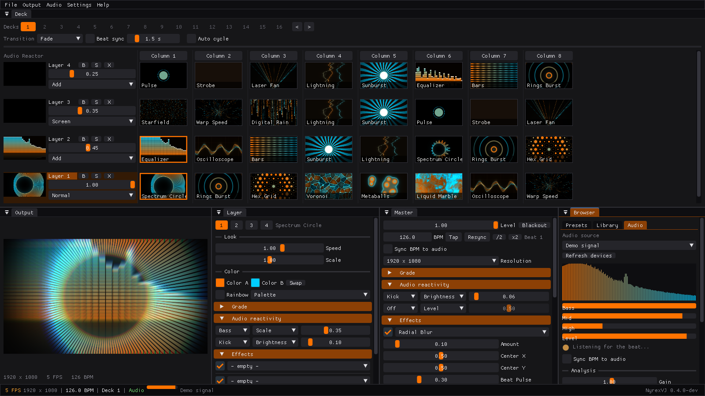
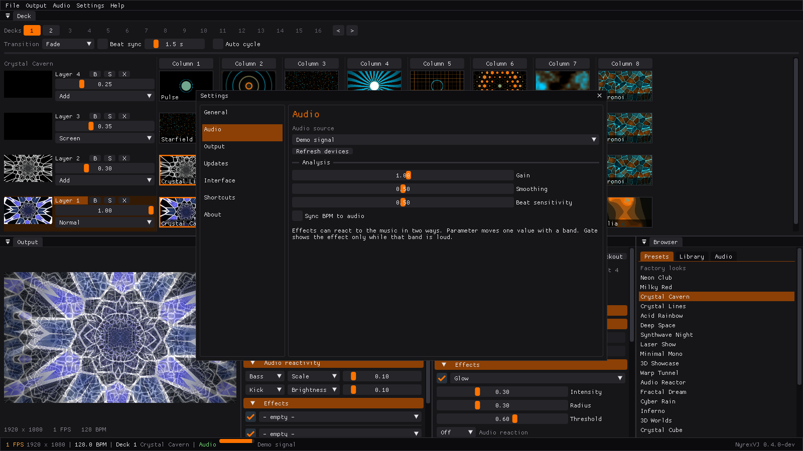

<p align="center">
  
</p>

<h1 align="center">NyrexVJ</h1>

<p align="center">
  Live-Visuals für VRChat-Events und Partys. Natives C++ und OpenGL, keine Game-Engine, eine einzige Windows-Exe.<br>
  <a href="README.md">English</a> · <a href="CHANGELOG.de.md">Änderungsprotokoll</a> · <a href="https://github.com/MarlonXDev/NyrexVJ/releases">Releases</a>
</p>

<p align="center">
  
</p>

NyrexVJ spielt generative Clips auf Ebenen ab, legt Effekte darüber, folgt deiner Musik und schickt das Bild per Spout an OBS oder in ein Vollbild-Ausgabefenster. Das Programm orientiert sich an Resolume Arena und startet trotzdem in einer Sekunde.

> Stand: v0.4.0. Clips, Effekte, 16 Decks mit weichen Übergängen, Presets, Audio-Reaktivität, Spout-Ausgabe, Ausgabefenster, Einstellungsfenster, Englisch und Deutsch sowie der Auto-Updater funktionieren. Video-Clips und MIDI gibt es noch nicht.

## Download

Lade `NyrexVJ.exe` von der [Release-Seite](https://github.com/MarlonXDev/NyrexVJ/releases) herunter. Es ist eine einzelne Datei, eine Installation ist nicht nötig. Windows SmartScreen kann warnen, weil die Exe nicht signiert ist: "Weitere Informationen" und "Trotzdem ausführen" wählen.

Im Release liegen außerdem `NyrexVJ-windows-x64.zip` (Exe, Changelogs, Readmes) und `SHA256SUMS.txt`.

## Highlights

- **16 Decks, weiche Übergänge.** Richte bis zu 16 Looks ein und gleite mit Ausblenden, Auflösen, Zoom, Wischen, Kreis, Rotation oder Schieben dazwischen hin und her, in Sekunden oder Beats, auf Wunsch mit automatischem Wechsel.
- **Audio-reaktiv.** Wähle Systemaudio (dein DJ-Programm), ein Mikrofon, einen Line-In oder ein Demo-Signal. Ebenen, Master und jeder Effektparameter können Bass, Mitten, Höhen, Pegel oder Kick folgen, und ein Effekt lässt sich auf Gate stellen, damit er nur bei lauter Musik sichtbar ist.
- **OBS mit zwei Klicks.** Spout-Ausgabe mit frei wählbarem Sendernamen. In OBS die Quelle "Spout2 Capture" hinzufügen und den Sender auswählen.
- **35 Clips, 58 Effekte, 18 Presets.** Fraktale, 3D-Szenen mit Raymarching, Konturlinien-Flüssigkeiten, Kristalltunnel, Blitze, Feuer, Spektrum-Visuals und mehr.
- **Einstellungsfenster.** Ein Ort für Audio, Ausgabe, Spout, Updates, Sprache und Oberflächengröße, dazu eine Statusleiste mit FPS, Tempo, Deck und Audio auf einen Blick.
- **Englisch und Deutsch.** Englisch ist Standard, umschalten jederzeit unter Einstellungen, Allgemein.
- **Willkommensbildschirm.** Beim ersten Start und nach jedem Update, mit allem, was neu ist.
- **Aktualisiert sich selbst.** Prüft GitHub beim Start, kontrolliert die SHA-256-Summe und zeigt oben rechts eine kleine Karte mit Jetzt neu starten oder Später.

<p align="center">
  
</p>

## Decks

Die Zeile über dem Clip-Raster enthält 16 Deck-Knöpfe. Jedes Deck ist ein vollständiger Satz aus vier Ebenen, acht Spalten, Effekten und Farben. Ein Klick auf einen Knopf wechselt das Deck, das neue Deck übernimmt mit einem Übergang statt eines Schnitts. Das aktuelle Deck ist orange, leere Decks sind gedimmt und starten leer, wenn du sie anklickst.

| Übergang | Aussehen |
| --- | --- |
| Ausblenden | Weiche Überblendung |
| Auflösen | Verrauschtes Durchbrennen mit leuchtender Kante |
| Zoom | Zieht durch das alte Bild ins neue |
| Wischen | Weicher diagonaler Wisch |
| Kreis | Kreis, der sich aus der Mitte öffnet |
| Rotation | Beide Bilder drehen sich ineinander |
| Schieben | Neues Deck schiebt sich von der Seite herein |

Stelle die Dauer in Sekunden ein oder hake Beat-Sync an, um in Beats zu zählen, und hake Auto-Wechsel an, um alle 4 bis 128 Beats durch die benutzten Decks zu schalten. Wechselst du mitten im Übergang erneut, friert das aktuell sichtbare Bild ein und blendet von dort aus weiter, es gibt also nie einen Sprung.

Rechtsklick auf einen Deck-Knopf: umbenennen, aktuelles Deck hierher kopieren, mit einem Werks-Look füllen, leeren oder entfernen. Im Presets-Tab lädt ein Klick auf einen Werks-Look ihn ins aktuelle Deck, und "Decks mit Werks-Looks füllen" legt 16 Looks in die 16 Decks. Decks werden mit dem Preset und mit der Sitzung gespeichert.

## Audio

Öffne den Audio-Tab im Browser-Panel oder Einstellungen, Audio.

| Quelle | Worauf gehört wird |
| --- | --- |
| Ausgabegeräte (Loopback) | Alles, was dein PC abspielt, zum Beispiel Rekordbox, Serato, Spotify oder ein Browser |
| Eingabegeräte | Mikrofon oder Line-In |
| Demo-Signal | Ein eingebauter Beat, damit du ohne Musik Looks bauen kannst |

Der Tab zeigt das Live-Spektrum, Bass-, Mitten-, Höhen- und Pegelanzeigen, Beat-Erkennung und eine Tempo-Schätzung. Verstärkung, Glättung und Beat-Schwelle sind in Einstellungen, Audio einstellbar, und "BPM mit Audio synchronisieren" koppelt das Tempo an den erkannten Beat. Liefert das gewählte Gerät mehrere Sekunden lang keinen Ton, weisen der Tab und die Statusleiste darauf hin.

<p align="center">
  
</p>

Die Reaktivität stellst du an drei Stellen ein:

- **Ebenen-Panel**: zwei Modulationsplätze pro Ebene (Band auf Deckkraft, Skalierung, Geschwindigkeit, Farbton, Helligkeit oder Sättigung, mit einer Stärke).
- **Master-Panel**: dasselbe für das fertige Bild.
- **Jeder Effektplatz**: ein Band und ein Modus. Im Modus Parameter bewegt das Band einen Effektwert um eine Stärke. Im Modus Gate ist der Effekt nur sichtbar, solange das Band laut ist, und blendet in der Stille aus, die Stärke bestimmt die Empfindlichkeit.

Bars, Equalizer, Spectrum Circle, Oscilloscope, Spectrum Warp und der Effekt Oscilloscope zeichnen das echte Spektrum oder die Wellenform. Ohne Audioquelle laufen sie auf einem virtuellen Beat, der dem BPM folgt.

## Spout und OBS

1. In NyrexVJ unter Einstellungen, Ausgabe (oder im Menü Ausgabe) "Per Spout an OBS senden" anhaken und einen Sendernamen wählen.
2. In OBS einmalig das [obs-spout2-plugin](https://github.com/Off-World-Live/obs-spout2-plugin) installieren.
3. Eine Quelle "Spout2 Capture" hinzufügen und den Sender aus der Liste wählen.

Spout gibt es nur unter Windows. Das Ausgabefenster (F11) mit OBS-Fensteraufnahme funktioniert weiterhin als Alternative.

## Clips und Effekte

<p align="center">
  
</p>

Jede Ebene hat vier Effektplätze, der Master ebenfalls.

<p align="center">
  
</p>

Die Effekt-Galerie zeigt jeden Effekt mit Standardwerten auf dem Clip Plasma (Duotone auf Mandelbrot und Line Art auf Crystal Cavern, weil Plasma kaum Helligkeitskontrast hat). Clip- und Effektnamen bleiben englisch, damit sie zu anderen VJ-Programmen passen.

## Presets

18 fertige Looks: Neon Club, Milky Red, Crystal Cavern, Crystal Lines, Acid Rainbow, Deep Space, Synthwave Night, Laser Show, Minimal Mono, 3D Showcase, Warp Tunnel, Audio Reactor, Fractal Dream, Cyber Rain, Inferno, 3D Worlds, Crystal Cube und Pop Art. Eigene Looks speicherst du im Presets-Tab, ein gespeichertes Preset enthält alle 16 Decks. Die letzte Sitzung wird beim Start wiederhergestellt.

## Bedienung

| Eingabe | Aktion |
| --- | --- |
| Klick auf eine Zelle | Clip auf seiner Ebene abspielen |
| Klick auf einen Spaltenkopf oder Tasten 1 bis 8 | Ganze Spalte auslösen |
| Leertaste | Tap Tempo |
| Bild auf / Bild ab | Vorheriges / nächstes benutztes Deck |
| Strg + 1 bis 8, Strg + Umschalt + 1 bis 8 | Deck 1 bis 8, Deck 9 bis 16 |
| Strg + , | Einstellungen öffnen |
| B | Blackout |
| F11 | Vollbild-Ausgabefenster |
| Esc | Vollbild verlassen |
| Rechtsklick auf eine Zelle | Clip zuweisen oder entfernen |
| Rechtsklick auf einen Deck-Knopf | Deck umbenennen, kopieren, füllen, leeren oder entfernen |
| Rechtsklick auf einen Regler | Auf Standardwert zurücksetzen |
| Aus der Bibliothek auf eine Zelle ziehen | Clip zuweisen |
| B / S / X an einer Ebene | Bypass / Solo / Ebene stoppen |

## Sprachen

Englisch ist die Standardsprache, Deutsch ist eingebaut. Umschalten unter Einstellungen, Allgemein, unter Hilfe, Sprache oder auf dem Willkommensbildschirm, die Wahl wird gespeichert. Für eine neue Sprache braucht es eine Übersetzungstabelle neben `src/core/i18n_de.cpp` und einen Eintrag in `src/core/i18n.cpp`.

## Auto-Update

NyrexVJ prüft beim Start GitHub (Einstellungen, Updates). Gibt es einen neueren Build, wird er im Hintergrund geladen und vorbereitet, und oben rechts erscheint eine Karte mit Jetzt neu starten und Später. Später verkleinert die Karte zu einem schmalen Hinweis, der bis zum Neustart bleibt. Schaltest du "Updates automatisch herunterladen" aus, gibt es stattdessen einen Installieren-Knopf.

| Kanal | Quelle | Aktualisiert, wenn |
| --- | --- | --- |
| Neuester Build (Standard) | rollender `nightly`-Prerelease | jeder Commit auf `main` |
| Stabil | neuestes GitHub-Release | ein neuer Versions-Tag veröffentlicht wird |

Der Updater funktioniert nur, solange das Repository öffentlich ist.

## Projektstruktur

```
NyrexVJ/
├── src/
│   ├── app/        Dear-ImGui-Oberfläche: Deck, Panels, Browser, Einstellungsfenster, Statusleiste, Update-Karte, Willkommensbildschirm, Theme
│   ├── audio/      WASAPI-Aufnahme und Loopback, FFT-Analyse, Beat- und Tempo-Erkennung
│   ├── core/       Kompositionsmodell, Presets, Einstellungen, i18n, Log, SHA-256
│   ├── render/     OpenGL-Engine, Clip- und Effektbibliothek, Ausgabefenster, Spout
│   ├── update/     Update-Prüfung, Installer, Changelog-Parser
│   ├── platform/   Windows- und Ersatz-Plattformcode
│   └── main.cpp
├── tests/          Unit-Tests für Core, Audio, i18n und Update-Logik
├── scripts/        Repository-Prüfungen (Übersetzungsabdeckung)
├── resources/      Windows-Icon und Ressourcenvorlage
├── docs/           Bilder für die Readme
├── third_party/    Mitgelieferte Bibliotheken glad und nlohmann/json
└── .github/        CI, Issue-Vorlagen
```

## Selbst bauen

Voraussetzungen: CMake 3.21 oder neuer, ein C++20-Compiler und eine GPU mit OpenGL 3.3.

Windows mit Visual Studio:

```
cmake -S . -B build -A x64
cmake --build build --config Release
ctest --test-dir build -C Release
```

Unter Linux werden die X11-Entwicklungspakete gebraucht, die GLFW verlangt (Xrandr, Xinerama, Xcursor, Xi):

```
cmake -S . -B build -G Ninja
cmake --build build
ctest --test-dir build
```

GLFW, Dear ImGui und Spout2 (Windows) lädt CMake beim Konfigurieren herunter. Audioaufnahme und Spout gibt es nur unter Windows, auf anderen Systemen wird das Demo-Signal benutzt.

## Tests

```
ctest --test-dir build
python scripts/check_i18n.py
NyrexVJ --check-shaders
```

`check_i18n.py` stellt sicher, dass jeder Oberflächentext eine deutsche Übersetzung hat. `--check-shaders` kompiliert jeden Clip und Effekt und beendet sich bei einem Fehler mit Code 1. Die CI führt alles bei jedem Push aus.

## Release veröffentlichen

1. Version in `CMakeLists.txt` erhöhen (`project(NyrexVJ VERSION x.y.z)`) und einen Abschnitt in `CHANGELOG.md` und `CHANGELOG.de.md` ergänzen.
2. Committen, dann taggen und pushen: `git tag vx.y.z && git push origin vx.y.z`.
3. GitHub Actions baut, testet und veröffentlicht das Release mit `NyrexVJ.exe`, dem Zip und `SHA256SUMS.txt`. Der Release-Text stammt aus dem passenden Abschnitt von `CHANGELOG.md`.

Jeder Push auf `main` aktualisiert außerdem den `nightly`-Prerelease, dem der Standard-Updatekanal folgt.

## Kommandozeile

| Option | Wirkung |
| --- | --- |
| `--preset NAME` | Factory- oder eigenes Preset beim Start laden |
| `--column N` | Spalte N (ab 1) beim Start auslösen |
| `--clip NAME` | Mit leerem Deck starten, das nur diesen Clip spielt |
| `--effect NAME` | Effekt in den ersten Master-Effektplatz legen |
| `--select-layer N` | Ebene N (ab 1) auswählen |
| `--resolution IDX` | Index der Ausgabeauflösung |
| `--tab IDX` | Anzuzeigender Browser-Tab (0 Presets, 1 Bibliothek, 2 Audio) |
| `--settings IDX` | Einstellungsfenster auf Seite IDX öffnen (0 bis 6) |
| `--decks A,B,C` | Deck 1, 2, 3 mit diesen Werks-Looks füllen |
| `--transition NAME` | Übergangsart für Deckwechsel |
| `--transition-seconds S` | Übergangsdauer in Sekunden |
| `--switch-deck FRAME:DECK` | Mit `--frames` bei diesem Frame zu Deck DECK (ab 1) wechseln |
| `--dump-at FRAME:DATEI.png` | Mit `--frames` die Engine-Ausgabe bei diesem Frame speichern |
| `--demo-update ZUSTAND` | Update-Karte als `available`, `downloading`, `ready` oder `later` zeigen |
| `--output` | Ausgabefenster beim Start öffnen |
| `--lang en\|de` | In dieser Sprache starten |
| `--audio-demo` | Demo-Audiosignal benutzen |
| `--welcome` / `--no-welcome` | Willkommensbildschirm erzwingen oder überspringen |
| `--fresh` | Gespeicherte Sitzung ignorieren |
| `--no-update-check` | Update-Prüfung überspringen |
| `--check-shaders` | Alle Shader kompilieren und beenden |
| `--frames N` | N Frames mit festen 60 FPS rendern, dann beenden |
| `--screenshot DATEI.png` | Mit `--frames` das Fenster als PNG speichern |
| `--dump-output DATEI.png` | Mit `--frames` die Engine-Ausgabe als PNG speichern |

Nutzerdaten liegen unter Windows in `%APPDATA%\NyrexVJ` und unter Linux in `~/.config/NyrexVJ`: Log, Fensterlayout, Einstellungen, Autosave und `presets/`. Mit `NYREXVJ_DATA_DIR` lässt sich ein anderer Ordner wählen.

## Fahrplan

- Video-Clips (H.264 und HAP) über FFmpeg
- MIDI-Controller-Zuordnung
- OSC-Eingang
- DMX-Strip-Ausgabe für VRSL
- Eigene Shader-Clips aus Dateien
- Weitere Sprachen

## Software von Dritten

- [GLFW](https://www.glfw.org/) (zlib-Lizenz)
- [Dear ImGui](https://github.com/ocornut/imgui) (MIT)
- [Spout2](https://github.com/leadedge/Spout2) (BSD 2-Clause), nur Windows
- [glad](https://github.com/Dav1dde/glad) generierter OpenGL-Loader (WTFPL oder CC0, dazu Apache-2.0 für die Khronos-Teile)
- [stb_image_write](https://github.com/nothings/stb) (gemeinfrei oder MIT)
- [nlohmann/json](https://github.com/nlohmann/json) (MIT)

## Lizenz

MIT, siehe [LICENSE](LICENSE).
