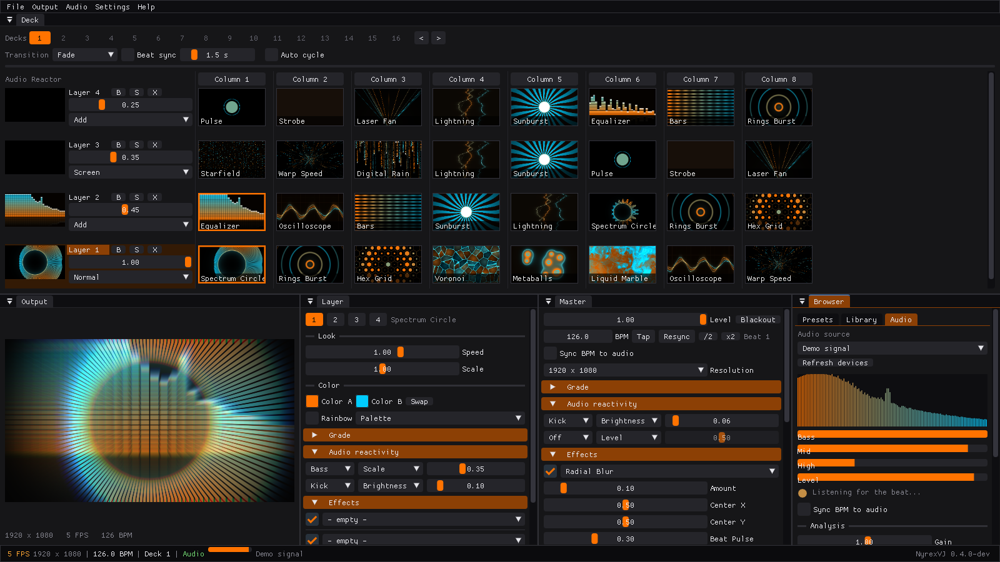

<p align="center">
  
</p>

<h1 align="center">NyrexVJ</h1>

<p align="center">
  Live visuals for VRChat events and parties. Native C++ and OpenGL, no game engine, one executable for Windows and one for Linux.<br>
  <a href="README.de.md">Deutsch</a> · <a href="CHANGELOG.md">Changelog</a> · <a href="https://github.com/MarlonXDev/NyrexVJ/releases">Releases</a>
</p>

<p align="center">
  
</p>

NyrexVJ plays generative clips on layers, stacks effects on top, follows your music and sends the picture to OBS with Spout or to a fullscreen output window. It is built in the spirit of Resolume Arena, small enough to start in a second.

> Status: v0.57.0. The list that follows was written at v0.26.0 and does not name everything added since; the [changelog](CHANGELOG.md) does. Windows and Linux builds, clips, effects, 16 decks with smooth transitions, presets, audio reactivity, Spout and NDI output, Spout input, NDI input and cameras or capture cards with automatic reconnecting (see [docs/LIVE.md](docs/LIVE.md)), up to four output windows with up to eight slices each, polygon masks, colour correction, projection mapping, warping, edge blending with black level and saved venue setups (see [docs/OUTPUTS.md](docs/OUTPUTS.md)), DMX over Art-Net, a VRSL strip in the video and VRChat OSC parameters (see [docs/DMX.md](docs/DMX.md)), one beat clock that follows tapping, audio, MIDI clock, LTC, MTC or Pro DJ Link beats, timecode cues and an output frame lock with delay and sync bars and a network sync that lets several PCs follow one master (see [docs/SYNC.md](docs/SYNC.md)), a node editor that builds your own effects from 68 nodes and shares them as files (see [docs/NODES.md](docs/NODES.md)), plugins that add modulation sources and image sources from your own libraries, off until you enable them (see [docs/PLUGINS.md](docs/PLUGINS.md)), a settings window, OSC control and OSC output, MIDI control, a 3D model player (glTF/GLB) with realistic lighting, the Clip Creator for your own 3D scenes, image clips with transparency, video clips (H.264, HEVC, AV1, HAP, with hardware decoding, GPU colour conversion, a frame rate limit and a video monitor, needs the FFmpeg libraries, see [docs/MEDIA.md](docs/MEDIA.md)) with reverse playback, scrubbing, in and out points, loop modes, clip speed, a clip length in beats and next clips prepared in the background, a render pass profiler, hidden layers that cost nothing and an optional reduced layer resolution (see [docs/PERFORMANCE.md](docs/PERFORMANCE.md)), your own shader clips from files, English, German, Spanish, French and your own languages an experimental Unreal Engine plugin (source only, not yet compiled with Unreal) and the auto-updater work.

## Download

Get `NyrexVJ.exe` from the [Releases page](https://github.com/MarlonXDev/NyrexVJ/releases). It is a single file, no installer needed. Windows SmartScreen may warn because the executable is not code-signed: choose "More info" and "Run anyway".

The release also contains `NyrexVJ-windows-x64.zip` (exe, changelogs, readmes) and `SHA256SUMS.txt`.

**Linux:** get `NyrexVJ-linux-x64` (a single file, run `chmod +x NyrexVJ-linux-x64`) or `NyrexVJ-linux-x64.tar.gz` (the program with licenses, changelogs and a list of its libraries) from the same page. It needs glibc 2.35 or newer (Ubuntu 22.04 or newer, Debian 12 or newer, Fedora, Arch), an X11 or XWayland session and a graphics driver with OpenGL 3.3. Audio capture works through PulseAudio or PipeWire, MIDI through ALSA, video clips need the FFmpeg libraries. Nothing has to be installed to start the program, see [docs/DEPENDENCIES.md](docs/DEPENDENCIES.md) for every optional library and [THIRD_PARTY_LICENSES.md](THIRD_PARTY_LICENSES.md) for the licenses. Verify the download with `SHA256SUMS.txt`.

## Highlights

- **16 decks, smooth transitions.** Set up to 16 looks and glide between them with Fade, Dissolve, Zoom, Wipe, Radial, Spin or Slide, timed in seconds or beats, with an optional auto cycle.
- **Audio reactive.** Pick system audio (your DJ program), a microphone, a line-in or a demo signal. Layers, the master and every effect parameter can follow Bass, Mid, High, Level or Kick, and an effect can be set to Gate so it only shows while the music is loud. Eight macro knobs and four tempo synced LFOs work as sources in the same places.
- **Live control.** Play it from a MIDI controller (learn a knob with one click, Windows) or remote control it over OSC from TouchDesigner, Max, Python and more. NyrexVJ can also send tempo, beats and audio levels back out over OSC. A web page in your browser (off by default, see [docs/API.md](docs/API.md)) controls the show from the same computer or from a phone, and a REST API serves scripts.
- **Unreal Engine and other programs.** Four Spout input clips show the picture of Unreal, TouchDesigner or a game (Windows), and the OSC output hands the tempo, beats, spectrum and your own named values to them. An experimental Unreal Engine plugin with Blueprint nodes is included as source in `integrations/unreal/NyrexVJ`, it has never been compiled with Unreal Engine. See [docs/UNREAL.md](docs/UNREAL.md).
- **Live video.** Four NDI input clips and four camera clips show the picture of another computer on the network, a webcam or a capture card. NDI senders are found automatically, a lost source is searched for again by itself, the picture goes to the graphics card as UYVY and is converted there, and a source costs nothing while no layer shows it. NDI needs the NDI Tools, cameras need the FFmpeg device library. See [docs/LIVE.md](docs/LIVE.md).
- **Recording.** Record the final picture of the show into a video file while it plays: H.264, HEVC and H.264 on the graphics card, ProRes, HAP, Motion JPEG, FFV1 or VP9, up to 3840 x 2160 and 120 frames per second, with sound from your audio input. Menu Output, Start recording, or `Ctrl+Shift+R`. The show does not wait for the encoder: frames that do not fit are dropped and counted, files survive a crash, a full disk ends the recording cleanly. Needs the FFmpeg libraries, see [docs/RECORDING.md](docs/RECORDING.md).
- **Show timeline.** An optional window (menu Timeline, off by default) that automates sliders and switches with keyframes (hold, linear or smooth) next to the cue list, follows LTC or MTC or runs on its own play button, loops, survives jumps and a lost timecode, lets your hand win when you move a slider, and has undo and redo (see [docs/TIMELINE.md](docs/TIMELINE.md)).
- **OBS in two clicks.** Spout output with a sender name of your choice. In OBS add the source "Spout2 Capture" and select the sender.
- **54 clips, 77 effects, 26 presets.** Fractals, raymarched 3D scenes, neon sacred geometry, laser webs, contour-line fluids, crystal tunnels, lightning, fire, spectrum visuals, real 3D models and scenes and 3D effects such as Image Terrain, Hyperspace, Chrome Liquid, Shatter and Mirror Corridor. Everything that is new in a version carries a small "new" behind its name until the next minor version.
- **Resolume-style layout.** Clip grid on top, deck and tempo rows below it, preview and output at the bottom left, Master, Layer and Clip windows next to them and the Browser on the right. A Pause button freezes the picture.
- **Ten colour themes.** Settings, Appearance switches the whole interface between Studio (default: neutral dark with a red-orange accent, rounded corners and slim sliders), Orange, Blue, Red, Green, Purple, Pink, Cyan, Gold and Mono.
- **Your own 3D models.** Drop .glb or .gltf files into the models folder and play them like any clip, with textures, animation and audio reaction.
- **Clip Creator.** Build your own 3D scenes from shapes, models and lights, let everything move with the music and save them as portable .nyxclip files.
- **Settings window.** One place for audio, output, Spout, updates, language and interface size, plus a status bar that shows FPS, tempo, deck and audio at a glance.
- **Your own effects from nodes.** The node editor (Creator menu, Node effect editor) turns a graph of 68 nodes (picture, audio, beat, LFO, macros, maths, colour, distortion, noise, shapes, a bounded blur) into one shader. The result is a normal effect with up to four controls, saved as a small `.nyxfx` file you can share. See [docs/NODES.md](docs/NODES.md).
- **Plugins.** A plugin is a library with a small C interface that adds modulation sources (a number from 0 to 1, about 60 times a second) and image sources (1280 x 720, about 30 frames a second). They appear as `Plugin 1` to `Plugin 8` next to the audio bands and as the clips `Plugin Source 1` to `Plugin Source 4`. Plugins are native code with no sandbox and are off until you enable them; a plugin that is too slow or fails is switched off for the session without stopping the picture, and one that crashes the program is not loaded again at the next start. See [docs/PLUGINS.md](docs/PLUGINS.md).
- **Your own shader clips.** Drop a .glsl, .frag or .fs file (your own or from Shadertoy) into the shaders folder and it becomes a clip, optionally with transparency, up to four feedback buffers (Buffer A to D) and images or videos as inputs. ISF files work too, as generators and as image filters in the effect list, with sliders for their inputs. See [docs/SHADERS.md](docs/SHADERS.md).
- **English, German, Spanish and French.** English is the default, switch any time under Help, Language. You can add your own language with a small .json file, see [docs/LANGUAGES.md](docs/LANGUAGES.md).
- **Video you can play.** Every video cell has a play head: scrub, step by frame, set in and out points, loop, ping-pong or play once, speed from -4x to +4x including backwards, or fit the clip to a number of beats. The next clip of each layer is prepared in the background, so a clip change shows no empty frame. See [docs/MEDIA.md](docs/MEDIA.md).
- **DXV videos to HAP, FFmpeg by button.** DXV videos (Resolume) need a lot of processor time. NyrexVJ can make HAP copies of them in the background (Normal and High Quality, with and without alpha), with progress and a Cancel button, in a cache that keeps your original files untouched, and plays the copy through the compressed HAP path (no processor decoding, a fraction of the video memory). The import mode is Off, Ask (the default) or Automatic. If FFmpeg is missing, one button downloads a ready-made LGPL build into the NyrexVJ folder after checking its checksum and licence, only when you press it and without touching an FFmpeg that is already installed. HAP Q with transparency is not supported. See [docs/MEDIA.md](docs/MEDIA.md) and [docs/FFMPEG.md](docs/FFMPEG.md).
- **Light on the graphics card.** Layers faded to zero opacity are not drawn, an optional layer resolution (Full, Balanced, Performance or Automatic) trades pixels for frame time, unused pictures are freed, and Settings, Performance shows which clip or effect takes the time. Measured numbers and limits are in [docs/PERFORMANCE.md](docs/PERFORMANCE.md).
- **Welcome screen.** Shown on the first start and after every update, with everything that is new.
- **Self-updating.** Checks GitHub on start, verifies the SHA-256 sum and shows a small card at the top right with Restart now or Later.

<p align="center">
  
</p>

<p align="center">
  
</p>

## User manual

NyrexVJ has a complete user manual: 36 chapters on how everything works and where to find it, from the first start to shows, outputs and troubleshooting. It is part of the program: **Help, User manual** or `F1` opens a window with contents, search, links between chapters and a Back button, and it works offline. The same text, with pictures, is on the website (`site/manual/`, in German `site/de/handbuch/`).

The manual is written in English and German. With the interface in German you see the German manual, with every other language the English one. The source is `docs/manual/`, how it is built and checked is in [docs/MANUAL.md](docs/MANUAL.md) and the website in [docs/WEBSITE.md](docs/WEBSITE.md).

## Live workflow

The Quantize menu in the transport bar (Off, Beat, Bar, 2 bars, 4 bars) makes clip, column and deck starts wait for the beat clock, whether they come from the mouse, the keyboard, MIDI, OSC, the web interface, cues or the timeline; it is off by default and starts launches at once when there is no usable beat clock. In the Library, right click a clip to mark it as a favorite, give it tags or replace it in every cell of every deck in one undoable step, and search with `tag:name` and `is:fav`. In Settings, Control you can send MIDI feedback to a controller (lit pads, moving faders, Windows only for now) and save and load named controller profiles. Details: [docs/WORKFLOW.md](docs/WORKFLOW.md).

## Decks

The row above the clip grid holds 16 deck buttons. Each deck is a full set of four layers, eight columns, effects and colours. Click a button to switch, the new deck takes over with a transition instead of a cut. The current deck is orange, empty decks are dim and start blank when you click them.

| Transition | Look |
| --- | --- |
| Fade | Smooth crossfade |
| Dissolve | Noisy burn-through with a glowing edge |
| Zoom | Pulls through the old picture into the new one |
| Wipe | Soft diagonal wipe |
| Radial | Circle that opens from the centre |
| Spin | Both pictures rotate into each other |
| Slide | New deck pushes in from the side |

Set the length in seconds or tick Beat sync to count in beats, and tick Auto cycle to step through the used decks every 4 to 128 beats. Switching again in the middle of a transition freezes the picture you see and fades from there, so there is never a jump.

Right click a deck button to rename it, copy the current deck into it, fill it with a factory look, clear it or remove it. In the Presets tab a click on a factory look loads it into the current deck, and "Fill the decks with factory looks" puts 16 looks into the 16 decks. Decks are saved with the preset and with the session.

## Audio

Open the Audio tab in the Browser panel, or Settings, Audio.

| Source | What it listens to |
| --- | --- |
| Output devices (loopback) | Whatever your PC plays, for example Rekordbox, Serato, Spotify or a browser. On Linux this is "System audio (default output)" and every monitor source of PulseAudio or PipeWire |
| Input devices | Microphone or line-in. On Linux "Default input" and every other PulseAudio or PipeWire source |
| Demo signal | A built-in beat so you can build looks without music |

The tab shows the live spectrum, Bass, Mid, High and Level meters, beat detection and a tempo estimate. Gain, smoothing and beat threshold are adjustable in Settings, Audio, and "Sync BPM to audio" locks the tempo to the detected beat. If the chosen device delivers no sound for a few seconds the tab and the status bar say so.

<p align="center">
  
</p>

Reactivity is set in three places:

- **Layer panel**: two modulation slots per layer (band to opacity, scale, speed, hue, brightness or saturation, with an amount).
- **Master panel**: the same for the final picture.
- **Every effect slot**: a band and a mode. In Parameter mode the band moves one effect value by an amount. In Gate mode the effect only shows while the band is loud and fades out in silence, the amount sets how sensitive it is.

Bars, Equalizer, Spectrum Circle, Oscilloscope, Spectrum Warp and the Oscilloscope effect draw the real spectrum or waveform. Without an audio source they run on a virtual beat that follows the BPM.

## Macros, LFOs and the beat grid

Every place that can follow Bass, Mid, High, Level or Kick (the two slots of a layer, the master and every effect slot) can follow three more kinds of source:

- **Macro 1 to 8**: knobs in the Master panel under Macros and LFOs. One macro can drive many parameters at once, and each knob can be mapped to a MIDI controller (Settings, Control) or set over OSC (`/nyrex/macro/1` to `/nyrex/macro/8`).
- **LFO 1 to 4**: tempo synced oscillators with the shapes Sine, Triangle, Saw, Square, Random and Smooth random. The cycle runs from a quarter beat to 32 beats and the phase sets where in its cycle the LFO starts. Because they count beats, Tap, Resync, Pause and the BPM move them along and a sweep never drifts off the beat.
- **Beat and Bar**: a ramp from 0 to 1 over one beat or one bar.

Click the beat display next to the tempo controls to open the beat grid: set the beats per bar (2 to 8), move the grid by a sixteenth of a beat with `<<` and `>>`, snap it to the nearest beat, or make the nearest beat the first beat of the bar. The details and the order of the sources are in [docs/MODULATION.md](docs/MODULATION.md).

## Spout and OBS

1. In NyrexVJ tick "Send to OBS via Spout" in Settings, Output (or the Output menu) and choose a sender name.
2. In OBS install the [obs-spout2-plugin](https://github.com/Off-World-Live/obs-spout2-plugin) once.
3. Add a source "Spout2 Capture" and pick the sender from the list.

Spout is Windows only. The output window (F11) with OBS window capture keeps working as an alternative.

### Spout input

Four clips, Spout Input 1 to 4 (Library filter Spout), show the picture that another program sends through Spout. Put one into a cell, select it and pick the sender in the Clip window, or leave it on Automatic, which takes the first sender that is not NyrexVJ's own output. The picture is fitted into the layer without stretching, goes through the layer effects like any clip, reconnects when the sender comes back and shows a placeholder while there is none. If the image arrives upside down, tick Flip the image vertically. The chosen senders are saved in the program settings. Windows only, on other systems `--spout-test-pattern` adds a test sender for trying it out. Details and the Unreal Engine setup are in [docs/UNREAL.md](docs/UNREAL.md).

### Live sources

Eight clips show a live picture: NDI Input 1 to 4 (the picture of another program or computer on the network) and Camera 1 to 4 (a webcam or a capture card), library filter Live. Put one into a cell, select it and choose the source in the Clip window. NDI senders are listed automatically, Automatic takes the first sender that is not NyrexVJ's own output. Cameras are listed with a Refresh button, and resolution and frame rate are a request that the device answers with its closest mode. The Clip window shows the state (Searching, Connecting, Live, Signal lost, Reconnecting), the size, frame rate, dropped pictures and the latency from arrival to the end of the upload. A lost source is searched for again by itself (0.5 seconds, then doubling up to 10 seconds); the last picture stays on the layer meanwhile. A source is opened when a layer shows its clip and closed three seconds after the last use, so it costs nothing while unused. NDI needs the NDI runtime, which is not shipped (install the free NDI Tools); cameras need the FFmpeg libraries including the device library. Everything, the measured numbers and what was not tested (no real camera, capture card or NDI runtime yet) is in [docs/LIVE.md](docs/LIVE.md).

## Outputs, mapping and NDI

Settings, Output has a tab for each of up to four output windows. Every output has its own display and up to eight slices, each with its own part of the picture, corner handles, a warp grid up to 17 x 17 (drag them in the live canvas), edge blending with a black level, brightness, a mask with a soft edge (a polygon with optional curved edges, a shape drawn freehand with the mouse, or a picture such as a PNG) and a test pattern, a colour correction for each slice and one for the whole output (gain per channel, saturation, contrast, gamma, black lift), and, if wanted, its own NDI source that carries the output exactly as the window shows it (masks, warp and colour included). Arrange outputs sets up a grid of overlapping projectors in one click. The outputs can be saved as a venue setup, a small JSON file per venue that can be loaded, duplicated, exported, imported (also by dropping the file on the window) or loaded at start with `--venue`. NDI sends the main picture, and on request every output, to OBS, Resolume or vMix over the network; the NDI library is not shipped, install the free NDI Tools. A memory budget of 384 MiB is tracked for masks, delay and NDI readback. Everything is explained in [docs/OUTPUTS.md](docs/OUTPUTS.md), including what is and is not tested (no real projectors, multi-monitor setup or NDI runtime yet).

## Show sync

One beat clock drives everything that follows the beat. Settings, Sync chooses its source: Automatic (the best source that is present, in this order: Pro DJ Link, timecode, MIDI clock, audio, manual) or one fixed source. The clock corrects a phase error gradually, so a picture on the beat does not stutter, and shows the active source, a lock state (Free running, Searching, Acquiring, Locked, Lost), the phase error in milliseconds and a latency offset of -500 to +500 ms. Timecode comes as LTC from an audio input of its own (24, 25, 29.97 drop frame and 30 frames a second) or as MTC over MIDI, and drives the clock position, two modulation sources (Timecode second and minute) and a cue list that fires any control target at a time. MIDI clock, start, stop and song position are followed, and Pro DJ Link beat packets are followed by a passive listener that never announces itself on the network and sends nothing (no play state, no master flag). StageLinq was evaluated and is not built, the reasons are in the document. Settings, Output, Frame lock draws all output windows first and swaps them right after each other, can delay each output by 0 to 8 frames, shows the measured swap skew and has a sync bars pattern to film several screens. It is not a hardware genlock. Everything, the numbers and the long list of what was not tested (no real players, mixers, timecode generators or projectors) is in [docs/SYNC.md](docs/SYNC.md).

## Show timeline

Menu Timeline, Run the timeline turns the timeline on (it is off by default) and Show timeline window opens it. Add a lane for any slider or switch with *Add lane*, double click a lane to add keyframes, drag them, and right click a keyframe to choose hold, linear or smooth. The cue list of Settings, Sync is drawn on the same ruler and its cues can be moved and added there. The position follows a timecode when there is one and otherwise runs on the window's own Play, Pause and Stop; Shift and drag on the ruler marks a loop. If you move a controlled slider by hand the timeline lets go of it (until the next keyframe segment or until you release it). Lanes are saved in `timeline.json`, separate from presets and from `cues.json`. Clips, columns and decks are triggers and belong on the cue lane; the controls of shader clips cannot be automated yet. Details, limits and what was not tested are in [docs/TIMELINE.md](docs/TIMELINE.md).

## Node effects

Creator, Node effect editor opens a graph editor. Right click to add a node, drag from a pin to connect, and the effect is saved and rebuilt a moment after every change. The status line shows whether it compiles, how often it reads the picture (at most 64) and the message on the node that is wrong; an invalid edit keeps the last good shader running. Nodes read the picture, the audio analysis, the beat, eight macros and four controls, and an LFO runs in the shader on the beat clock. A graph is compiled to one shader, so a node effect costs what the same effect written by hand costs: in a test against four hand written effects the effect times were equal within the spread of the runs and the three effects without feedback gave identical pictures. Effects are `.nyxfx` files in the `nodes` folder of the user data folder and show in the library as `Node: <name>`; import by dropping a file on the window. Four examples can be created with one button. There is no zoom and the editor was only driven by a script, see the list of what was not tested in [docs/NODES.md](docs/NODES.md).

## Plugins

Settings, Plugins lists the plugin folders found in the `plugins` folder of the user data folder. **A plugin is native code and runs with the same rights as NyrexVJ. There is no sandbox. Enable only plugins from sources you trust.** Plugins are off until you tick them, and `--no-plugins` switches them off for a run. A plugin source is picked for `Plugin 1` to `Plugin 8` (a modulation source, usable in every list of sources) or for one of four image slots (the clips `Plugin Source 1` to `Plugin Source 4`), and each source has up to four parameters. Plugin code never runs on the render thread: every call has a time budget, a plugin that is too slow, hangs or fails is switched off for the session, and a plugin that was running when the program crashed is put into safe mode and stays off until you enable it again. Plugin bands are not available in the stage. A C header (API 1.1, stable for every 1.x version), an example plugin and the full reference are in [docs/PLUGINS.md](docs/PLUGINS.md), the reasons in [ADR 0018](docs/adr/0018-plugin-system.md) and [ADR 0026](docs/adr/0026-plugin-system-2.md), which also evaluates running plugins in a process of their own (not built).

## Stage control: DMX, VRSL strip and VRChat

Settings, Stage turns any control into DMX. Each channel follows a fixed value or a modulation source (audio band, LFO, macro, beat, bar). The channels go out as Art-Net (for HNode, QLC+ or a lighting console), can be drawn as a 120 x 13 block strip into the output video for VRSL, and VRChat avatar parameters are sent over OSC. Test patterns help to check the setup. The channel to block order of the strip follows the public VRSL description but is not yet verified against a real VRSL world, and nothing was tried with real Art-Net nodes or VRChat yet, see [docs/DMX.md](docs/DMX.md).

## Clips and effects

<p align="center">
  
</p>

Every layer has four effect slots, and so does the master.

<p align="center">
  
</p>

The effect gallery shows each effect with default settings on the Plasma clip (Duotone on Mandelbrot and Line Art on Crystal Cavern, because Plasma has almost no brightness contrast).

## Your own shader clips

Any fragment shader can become a clip. Put a `.glsl`, `.frag` or `.fs` file into the shaders folder (Library, Open shaders folder, or drag the file onto the window) and it shows up in the Library as `Shader: file name`, filter Shaders. It works like every other clip: Speed, Scale, colours, effects, audio, LFOs and macros all apply. A saved change reloads it while it plays, and a compile error shows in the Clip window with the line number of your file. A line `#pragma nyrexvj alpha` makes the clip transparent, and sections (`buffer a` to `d`, `image`, `channel`) turn the file into a multipass shader with feedback; files without such a line behave exactly as before. Library, Create example shader writes a small shader to start from. NyrexVJ style (`void main()`) and Shadertoy style (`mainImage`) are found automatically, the uniforms, helpers and limits are in [docs/SHADERS.md](docs/SHADERS.md). ISF files (a `/*{ ... }*/` header, the format of VDMX and others) are read from the same folder: a file with an `inputImage` input becomes an effect named `ISF: file name`, any other becomes a clip, and the inputs show as controls in the Clip window (or as the four controls of the effect). What an ISF file cannot do (vertex shaders, transitions, audio inputs and more) is listed in the Clip window and in [docs/SHADERS.md](docs/SHADERS.md). Seven examples, two for the NyrexVJ and Shadertoy styles and five for ISF, are in `docs/shaders/`.

## 3D models

Besides shader clips there are clips that draw real 3D meshes: Torus Knot Mesh, Crystal Cluster Mesh, Orbit Rings Mesh, Chrome Orbs Mesh, Neon Cubes Mesh, Gold Knot Mesh and Pulse Columns Mesh. They sit in the Library tab like every other clip, follow the layer colours, speed and scale, pulse with bass and kick and go through the same effects.

To play your own model, put a `.glb` or `.gltf` file into the models folder (`%APPDATA%\NyrexVJ\models`, the Library tab shows the path and has a button that opens it) and press Scan again in the Library tab (no restart needed). It appears as `Model: file name`. Textures (PNG and JPEG), node animation, skinned characters (skeletal animation), morph targets (blend shapes) and several meshes are supported. A model loads in the background the first time a deck contains it, so the picture never stalls, with a time limit of 60 seconds and a Cancel loading button, and a file that is damaged, too large or uses an unsupported feature is refused with a message in the log and in the clip tooltip. Layers that play the same model share it in memory.

Models with metallic-roughness materials, normal maps, emissive maps and cut-out transparency are drawn with physically based lighting. Blended transparency (`alphaMode` `BLEND`) is sorted back to front per mesh. Files compressed with Meshopt are read by default, Draco files only in a build made with `-DNYREXVJ_DRACO=ON` (otherwise they are refused with a message that names the option). Lights and cameras inside a file are counted but not used, the scene keeps its own. Limits protect the video memory (128 joints per skin, 32 morph targets, 640 MiB per scene). Not supported yet: tangents and second UV sets, texture transforms and material extensions beyond emissive strength. The full list of limits and the measurements are in [docs/SCENE3D.md](docs/SCENE3D.md).

### Clip Creator

The Creator menu opens the Clip Creator. The left column lists the objects and lights of the scene, the middle shows a live preview (drag to orbit, mouse wheel to zoom, Use this view as the clip camera keeps the view), the right column is the inspector for transform, repeat, material, textures, animation, audio reactions, cameras, sky and exposure. A scene can hold up to eight cameras: pick the one that plays, or let the clip cut between all of them every few beats. Start from a template (Creator menu, Start from a template, or Open in the window) or from an empty scene (New).

Save writes a `.nyxclip` file into the clips folder (`%APPDATA%\NyrexVJ\clips`). It contains the scene description and, as copies, the .glb models and PNG or JPEG textures the scene uses (up to 200 MiB), so one file is all you need to share a scene. It then shows up in the Library under Scenes as `Scene: name`. Use as clip also puts it into the selected cell. Only `.glb` models can be stored in a scene, `.gltf` files that need separate files are listed in the Assets view but cannot be used. The file format and the decisions behind it are in [docs/adr/0004-scene-document-and-clip-pack.md](docs/adr/0004-scene-document-and-clip-pack.md), the lighting model in [docs/adr/0005-pbr-shading.md](docs/adr/0005-pbr-shading.md) and the editor in [docs/adr/0006-clip-creator.md](docs/adr/0006-clip-creator.md).

## Presets

18 factory looks: Neon Club, Milky Red, Crystal Cavern, Crystal Lines, Acid Rainbow, Deep Space, Synthwave Night, Laser Show, Minimal Mono, 3D Showcase, Warp Tunnel, Audio Reactor, Fractal Dream, Cyber Rain, Inferno, 3D Worlds, Crystal Cube and Pop Art. Save your own in the Presets tab, a saved preset contains all 16 decks. The last session is restored on start. File, Export show package packs the current show and every file it uses into one `.nyxshow` file that you can copy to another computer, and File, Import show package (or dropping the file on the window) shows what would happen before it changes anything, keeps your own files unless you choose otherwise and puts everything back if something fails; plugins are never part of a package. Details: [docs/SHOWS.md](docs/SHOWS.md). File, Install community package opens a `.nyxpack` file from somebody else (presets, shaders, node effects, masks, venue setups and sometimes a plugin) with a versioned manifest, licence, dependencies and the NyrexVJ versions it fits: you see a plan first, your own files are never replaced without asking, a plugin needs your consent and is left switched off, and updates and removals move files to a backup. Details: [docs/PACKAGES.md](docs/PACKAGES.md). Creator, Text and particles... makes text clips (your own font, Unicode, alignment, eight animations, transparent background) and particle clips (a capped number of particles, bursts on the beat, the music level as modulation) that play like any other clip, and Creator, Effect chains... saves the four effects of a layer as a chain you can search, preview, apply, export and import. Details and limits: [docs/GENERATORS.md](docs/GENERATORS.md).

## Controls

| Input | Action |
| --- | --- |
| Click a cell | Play that clip on its layer |
| Click a column header, or keys 1 to 8 | Trigger the whole column |
| Space | Tap tempo |
| Page Up / Page Down | Previous / next used deck |
| Ctrl + 1 to 8, Ctrl + Shift + 1 to 8 | Deck 1 to 8, deck 9 to 16 |
| Ctrl + , | Open Settings |
| B | Blackout |
| F11 | Fullscreen output window |
| Esc | Leave fullscreen |
| Right-click a cell | Assign or clear a clip |
| Right-click a deck button | Rename, copy, fill, clear or remove the deck |
| Right-click a slider | Reset it to its default |
| Click a clip in the Library | Put it into the selected cell and play it |
| Drag from Library to a cell or column header | Assign a clip |
| Click or drag an effect in the Library | Add it to the selected layer |
| B / S / X on a layer | Bypass / solo / stop the layer |

## Live control

Everything lives under Settings, Control. Mappings and addresses refer to the working deck, the one you see in the clip grid.

### MIDI

Windows and Linux (on Linux the controller must show up as an ALSA sequencer port, `aconnect -l` lists them). Pick your controller under Device, press Add mapping, choose what it should control and then move a knob or press a key on the controller. The two are linked from that moment on. Knobs and faders (CC) set values, keys (notes) fire triggers or switch things on while held. Tick Invert to flip a fader, press Learn to give a row a new knob and Remove to delete it. Mappings are saved in `controls.json` in the user data folder. Controllers that another program has opened exclusively cannot be used by two programs at once.

### OSC

Tick Receive OSC messages. OSC is off by default and listens on port 9010 (VRChat uses 9000, so the two do not collide). Only this computer can send to it unless you tick Accept messages from other computers, which lets anyone on your network control NyrexVJ. Send one number to an address. Floats, integers and true or false are accepted and are read as 0 to 1. A message without a value fires a trigger or flips a switch. The Settings page lists every address, click one to copy it.

| Address | Meaning |
| --- | --- |
| `/nyrex/master/level` | Master level, 0 to 1 |
| `/nyrex/master/blackout` | Blackout, on at 0.5 and above |
| `/nyrex/master/bpm` | Tempo, 0 to 1 maps to 40 to 240 BPM |
| `/nyrex/master/tap`, `/nyrex/master/resync` | Tap tempo, restart the beat |
| `/nyrex/master/hue`, `saturation`, `brightness`, `contrast` | Master colour, 0 to 1 over the usual range of each |
| `/nyrex/deck/1` to `/nyrex/deck/16` | Switch to that deck |
| `/nyrex/deck/next`, `/nyrex/deck/previous` | Next or previous used deck |
| `/nyrex/column/1` to `/nyrex/column/8` | Trigger a column |
| `/nyrex/layer/L/clip/C` | Trigger the clip of layer L in column C |
| `/nyrex/layer/L/opacity`, `speed`, `scale` | Layer values, speed 0.1 to 4 and scale 0.25 to 4 |
| `/nyrex/layer/L/hue`, `saturation`, `brightness`, `contrast` | Layer colour |
| `/nyrex/layer/L/bypass`, `solo` | Layer switches |
| `/nyrex/layer/L/clear` | Stop the layer |
| `/nyrex/layer/L/fx/S/enable` | Effect slot S on or off |
| `/nyrex/layer/L/fx/S/param/P` | Parameter P of the effect in slot S |
| `/nyrex/master/fx/S/enable`, `/nyrex/master/fx/S/param/P` | The same for the master effects |

Layers go from 1 to 4, effect slots from 1 to 4 and parameters from 1 to 4. A quick test from Python with the `python-osc` package: `SimpleUDPClient("127.0.0.1", 9010).send_message("/nyrex/master/level", 0.5)`.

### OSC output

Settings, Control, OSC output, tick Send OSC data. NyrexVJ then sends to `127.0.0.1` port 9011, 60 times per second (address, port and rate can be changed, only IPv4 addresses and `localhost` are accepted). Everything starts with `/nyrex/out/`: `hello` (every 2 s, with the schema number 1), `audio` (bass, mid, high, level, kick), `spectrum` (32 bands), `clock` (BPM, beat number, position in the beat), `beat` and `onset` (events), and `param/<name>` for up to 16 values of your own, each following one control such as `layer/1/opacity`. The full table, the versioning rules and the Unreal Engine setup are in [docs/UNREAL.md](docs/UNREAL.md) and [ADR 0008](docs/adr/0008-osc-output-protocol.md).

### Web interface

Settings, Control, Web interface, tick Turn on the web interface, then click Open web interface. NyrexVJ starts a small web server on `127.0.0.1` port 9020 (changeable) and opens a page in your browser that controls the show: status, master level, blackout, tap tempo, the 16 decks, the column triggers, the clip grid of all four layers with opacity, bypass, solo and clear, the factory looks and your own looks, and the outputs. It is off until you turn it on and only this computer can reach it unless you also tick Allow other devices on the network, which lets anyone on your network who has the token control NyrexVJ over a connection that is not encrypted. Every request needs the token (shown on the Settings page, kept in its own file, New token replaces it). The same server is a documented REST API under `/api/v1/` for scripts. See [docs/API.md](docs/API.md) for the addresses, the security model, the measurements and what was not tested, and [ADR 0029](docs/adr/0029-rest-api.md).

## Languages

English is the default. German, Spanish, French, Italian, Portuguese, Dutch and Japanese are built in. Change it under Settings, General, under Help, Language or on the welcome screen, the choice is saved. Everything except German was translated with machine help and is not reviewed by native speakers yet, corrections are welcome. Japanese needs a Japanese font on the computer (Yu Gothic or Meiryo on Windows, Noto Sans CJK on Linux): NyrexVJ adds it to its own font only for the characters that are missing, nothing is bundled, and without one the Japanese text cannot be shown and Settings says so. Clip and effect names stay in English so they match what other VJ programs call them.

Your own language is a `.json` file in the `languages` folder: Settings, General, Export translation template writes a file with every text, you translate what you want (texts you leave out stay English) and press Reload languages. The font shows Latin letters only. Everything is explained in [docs/LANGUAGES.md](docs/LANGUAGES.md).

## Auto-update

NyrexVJ checks GitHub on start (Settings, Updates). When a newer build exists it is downloaded and prepared in the background, and a card appears at the top right with Restart now and Later. Later shrinks the card to a slim badge that stays until you restart. Turn off "Download updates automatically" to get an Install button instead.

| Channel | Source | Updates when |
| --- | --- | --- |
| Latest build (default) | rolling `nightly` pre-release | every commit on `main` |
| Stable | latest GitHub Release | a new version tag is published |

The updater only works while the repository is public. On Windows it replaces `NyrexVJ.exe`, on Linux it replaces the running `NyrexVJ-linux-x64` file in place and needs libcurl (`libcurl.so.4`, installed on almost every system). Both download the file that belongs to the platform and install it only when its SHA-256 matches `SHA256SUMS.txt` and it really is a program for that system.

## Project layout

```
NyrexVJ/
├── src/
│   ├── app/        Dear ImGui interface: deck, panels, browser, settings window, node effect editor, status bar, update card, welcome screen, theme
│   ├── audio/      WASAPI and PulseAudio capture and loopback, FFT analysis, beat and tempo detection
│   ├── control/    OSC parser, UDP input and output, the web interface and REST API (HTTP server, router, security, page), OSC sender, Art-Net and VRChat sender, MIDI input (WinMM, ALSA), learn mapping, control targets, sync system, Pro DJ Link listener
│   ├── core/       Composition model, presets, settings, i18n, log, SHA-256, beat clock, timecode, LTC, MIDI clock, Pro DJ Link, cue list, show timeline model, frame lock logic, node graph, node compiler and effect files, plugin host, manifest and settings
│   ├── render/     OpenGL engine, clip and effect libraries, shader parser and ISF translator, 3D scene player, output windows with mapping, Spout and NDI output, DMX strip, Spout input, NDI and camera input
│   ├── scene3d/    glTF/GLB loader with safety limits, scene model, scene documents and .nyxclip packs, built-in 3D scenes, GLB writer
│   ├── update/     Update check, installer, changelog parser
│   ├── platform/   Windows code, Linux updater, fallback platform code (everything that depends on the operating system lives in `*_win.cpp`, `*_linux.cpp` and `*_other.cpp` files)
│   └── main.cpp
├── tests/          Unit tests for core, audio, control, i18n and update logic
├── scripts/        Repository checks (translation coverage, test matrix, website), video and render benchmark helpers, the generators for the website pages and the manual pictures
├── integrations/   Experimental Unreal Engine plugin (source only)
├── plugins/        Plugin header (`include/nyrexvj_plugin.h`) and the example plugin
├── resources/      Windows icon and resource template
├── docs/           Guides, the manual sources (`docs/manual/`), decisions (ADRs), the interface list and images used by this readme
├── site/           The website for GitHub Pages, with the manual as web pages (mostly generated)
├── third_party/    Vendored glad and nlohmann/json
└── .github/        CI, issue templates
```

## Build from source

Requirements: CMake 3.21 or newer, a C++20 compiler and a GPU with OpenGL 3.3.

Windows with Visual Studio:

```
cmake -S . -B build -A x64
cmake --build build --config Release
ctest --test-dir build -C Release
```

Linux needs the X11 development packages that GLFW requires and an OpenGL development package (on Debian and Ubuntu `sudo apt install ninja-build libx11-dev libxrandr-dev libxinerama-dev libxcursor-dev libxi-dev libxext-dev libgl1-mesa-dev`):

```
cmake -S . -B build -G Ninja
cmake --build build
ctest --test-dir build
```

GLFW, Dear ImGui and Spout2 (Windows) are downloaded by CMake during configuration. Spout is Windows only. Audio capture, MIDI and the updater work on Linux through PulseAudio (or PipeWire), ALSA and libcurl, which are opened at run time, so nothing else is needed to build. Without a capture device the audio demo signal is used. Add `-DGLFW_BUILD_WAYLAND=OFF` to build for X11 and XWayland only, which is what the Linux release does. The list of everything the program needs is in [docs/DEPENDENCIES.md](docs/DEPENDENCIES.md).

## Tests

```
ctest --test-dir build
python scripts/check_i18n.py
python scripts/build_manual_site.py --check
NyrexVJ --check-shaders
```

`build_manual_site.py --check` checks that the website pages made from the manual are up to date and that the manual and the website keep their rules (see [docs/MANUAL.md](docs/MANUAL.md)). `check_i18n.py` makes sure every UI string has a German translation and that the Spanish and French tables match the German one. `--check-shaders` compiles every clip and effect (and 129 node graphs) and exits with code 1 on any failure. `--plugin-selftest build/plugins/nyrexvj-example` loads the example plugin. CI runs all of it on Windows and on Linux (Ubuntu 22.04, with a short start of the program on a virtual display) for every push and pull request.

## Releasing

1. Bump the version in `CMakeLists.txt` (`project(NyrexVJ VERSION x.y.z)`) and add a section to `CHANGELOG.md` and `CHANGELOG.de.md`.
2. Commit, then tag and push: `git tag vx.y.z && git push origin vx.y.z`.
3. GitHub Actions builds and tests on Windows and Linux and publishes the Release with `NyrexVJ.exe`, the zip, `NyrexVJ-linux-x64`, the tar.gz and `SHA256SUMS.txt` (one line per program). A release is only published when both builds succeed. The release text comes from the matching `CHANGELOG.md` section.

Every push to `main` also refreshes the `nightly` pre-release that the default update channel follows. When the Linux build fails, the nightly still gets the Windows files.

## Command line

| Option | Effect |
| --- | --- |
| `--preset NAME` | Load a factory or user preset on start |
| `--column N` | Trigger column N (1-based) on start |
| `--clip NAME` | Start with an empty deck that plays only this clip |
| `--effect NAME` | Put an effect in the first master effect slot |
| `--select-layer N` | Select layer N (1-based) |
| `--resolution IDX` | Output resolution index |
| `--tab IDX` | Browser tab to show (0 Presets, 1 Library, 2 Audio) |
| `--settings IDX` | Open the settings window on page IDX (0 to 12 in the order of the list on the left: 0 General, 5 Control, 6 Stage, 7 Sync, 10 Performance, 12 About) |
| `--osc-port N` | Listen for OSC on port N even if it is switched off in the settings |
| `--spout-test-pattern` | Offer a fake Spout sender called Test Pattern (for trying the Spout input without Windows) |
| `--midi-inject FRAME:STATUS:D1:D2` | With `--frames`, feed a MIDI message to the mappings at that frame |
| `--decks A,B,C` | Fill decks 1, 2, 3 with these factory looks |
| `--transition NAME` | Transition type for deck changes |
| `--transition-seconds S` | Transition length in seconds |
| `--switch-deck FRAME:DECK` | With `--frames`, switch to deck DECK (1-based) at that frame |
| `--dump-at FRAME:FILE.png` | With `--frames`, save the engine output at that frame |
| `--demo-update STATE` | Show the update card as `available`, `downloading`, `ready` or `later` |
| `--output` | Open the output window(s) on start |
| `--output-pattern` | Show the test pattern on all outputs |
| `--select-output N` | With `--settings`, show the tab of output N (1 to 4) |
| `--venue NAME\|PATH` | Load a saved venue setup (by name from the venues folder, or by file path) on start |
| `--ndi NAME` | Start the NDI sender with this name |
| `--lang CODE` | Start in this language: `en`, `de`, `es`, `fr` or the code of a language file |
| `--audio-demo` | Use the demo audio signal |
| `--welcome` / `--no-welcome` | Force or skip the welcome screen |
| `--fresh` | Ignore the saved session |
| `--crash-test` | Crash on purpose a second after the start to try the crash recovery |
| `--no-update-check` | Skip the update check |
| `--check-shaders` | Compile every shader and exit |
| `--bench-scene LAYERS:FRAMES[:CLIP]` | Measure frame times and memory with LAYERS (1 to 4) layers playing CLIP, then exit |
| `--bench-comp FRAMES` | Measure the loaded composition (CPU submit, GPU and total frame time) over FRAMES frames, then exit |
| `--bench-budget MS` | With `--bench-comp`, exit with code 2 when the average frame time is above MS |
| `--bench-all` | With `--bench-comp`, measure every factory look one after another |
| `--bench-out FILE.json` | With `--bench-scene` or `--bench-comp`, also write the result as JSON |
| `--profile` | With `--bench-comp`, time every render pass on its own and add the table to the JSON result |
| `--bench-shaders FRAMES` | Measure the GPU time of every clip alone and of every effect alone over FRAMES frames and print the most expensive ones (`--bench-out` writes JSON), then exit |
| `--bench-memory` | Report the size of the render targets while idle, during and after a deck transition and for each render quality, then exit |
| `--soak SECONDS[,FPS]` | Run a long show test in real time (looks, deck switches and quality changes on a timer), sample frame time, CPU, memory, graphics estimate, threads and handles, report growth, then exit; see [docs/TESTING.md](docs/TESTING.md) |
| `--soak-media FOLDER` | With `--soak`: instead of changing looks, copy the pictures, videos and 3D models of FOLDER into the data folder, launch and clear them on a timer, and count a clip that fails while it should play. Needs `NYREXVJ_DATA_DIR` to point at a scratch folder. The report names system, build, graphics card, driver, resolution, clips, effects and duration; `python3 scripts/release_gate.py` judges it; see [docs/RELEASE.md](docs/RELEASE.md) |
| `--creator [NAME]` | Open the Clip Creator at start, with the built-in scene of that name when one is given. For screenshots and tests |
| `--library-mode N` | Start with the library on page N: 0 Clips, 1 Effects, 2 Assets. For screenshots and tests |
| `--library-kind N` | Start with the clip list of the library on kind N (0 All, 1 2D, 2 3D, 3 Models, 4 Scenes, 5 Spout, 6 Media, 7 Shaders, 8 Live, 9 Generators, 10 Favorites). For screenshots and tests |
| `--record-selftest` | Send a test picture through the real recording and check what arrives at the encoder (orientation, colours, scaling, OpenGL state, slow encoder, size change, stall, cancel), exit with code 1 on an error |
| `--api-selftest` | Test the web interface and REST API through the real engine (off by default, token file, reads and writes, presets, stalled main thread, rate limit, lockout, new token), exit with code 1 on an error |
| `--bench-api [FRAMES]` | Measure the frame time with the web interface off, idle, with polling clients and under a flood (`--bench-out` writes JSON), then exit |
| `--bench-record [LIST[:FRAMES]]` | Record the output in every format of LIST (`all` or names such as `h264,prores,hap`) for FRAMES frames and print the time of the capture on the render thread, the encoder time, dropped frames and bit rate (`--bench-out` writes JSON), then exit |
| `--quality 0\|1\|2\|3` | Layer resolution for this run: 0 Full, 1 Balanced, 2 Performance, 3 Automatic |
| `--bench-video SECONDS:CLIP1,CLIP2` | Measure the processor time, decode time, upload time and video memory of the listed video clips playing for SECONDS, then exit (`--bench-out` writes JSON) |
| `--bench-convert RUNS:FILE1,FILE2` | Convert the listed DXV videos to HAP RUNS times without a window and print the time, decode and encode time, frames per second and size (`--convert-format auto\|hap\|hap_alpha\|hap_q` picks the format, `--convert-keep DIR` keeps the last copy, `--bench-out` writes JSON), then exit |
| `--bench-switch SECONDS:CLIP1,CLIP2,...` | Switch between the listed video clips (at least two) in layer 1 and count empty frames and the time to the first picture, then exit (`--bench-out` writes JSON) |
| `--no-prewarm` | Do not prepare the next clip of each layer in the background for this run |
| `--live-selftest` | Play a test source through the live path (conversion on the graphics card, colour, release after the idle time) and exit with code 1 on an error |
| `--node-editor [NAME]` | Open the node effect editor at start, with the effect NAME if given |
| `--timeline` | Open the show timeline window at start |
| `--show-packages [0\|1]` | Open the Show package window at start, on the Export tab (0, default) or the Import tab (1) |
| `--community-packages [0\|1\|2]` | Open the Community packages window at start, on the Installed tab (0, default), the Install tab (1) or the Create tab (2) |
| `--pack-build FOLDER FILE`, `--pack-info FILE`, `--pack-install FILE`, `--pack-remove ID` | Build, show, install or remove a community package without the window and exit; `--pack-accept-plugin`, `--pack-allow-downgrade`, `--pack-keep-mine`, `--pack-replace` and `--pack-overwrite` give the consent or the policy they name |
| `--generators [0\|1]` | Open the Text and particles window at start, on the Text tab (0, default) or the Particles tab (1) |
| `--chains [0..4]` | Open the Effect chains window at start for layer 1 to 4 (0 to 3) or the master (4), and `--chain-select NAME` selects a chain in it |
| `--generator-selftest [FRAMES]` | Run the text and particle checks in the real engine, with a benchmark over FRAMES frames if given, and exit with code 1 on a failure (`--bench-out` writes JSON) |
| `--generator-select NAME` | With `--generators`, open the window with that built-in particle clip or saved file |
| `--gpu-particles [0\|1]` | Turn the experimental GPU particles on (no value or 1) or off (0) for this start; the setting is kept like any change in Settings |
| `--gpu-particle-selftest [FRAMES]` | Run the GPU particle checks in the real engine (card against a processor reference, repeatability, budget, every fallback), with a benchmark of 16,384 to 1,048,576 particles at 1080p and 4K if FRAMES is given, and exit with code 1 on a failure (`--bench-out` writes JSON) |
| `--gpu-diag-selftest [FRAMES]` | Run the graphics memory checks in the real engine (memory budget release, playing clips kept, pressure steps, upload counter, driver readout) with eight large images that it imports and removes again, with a frame time comparison with the budget off and on if FRAMES is given, and exit with code 1 on a failure (`--bench-out` writes JSON) |
| `--shader-editor [FILE]` | Open the shader editor on start, with a file of the shaders folder if you give one, otherwise with a template |
| `--shader-editor-selftest [FRAMES]` | Run the shader editor checks in the real engine (valid and broken shaders, the last working version kept, the four templates, the cost control, an isolated preview, save and reload) with a benchmark if FRAMES is given |
| `--shader-editor-uitest` | Drive the shader editor with real key and mouse events and check what it holds; exit code 0 or 1 |
| `--interface-uitest` | Drive the interface with real key and mouse events (workspaces, shortcuts, window sizes and scales, high contrast, keyboard navigation, node canvas zoom) and check the result; exit code 0 or 1; use `NYREXVJ_DATA_DIR`, and `NYREXVJ_UITEST_SHOTS=FOLDER` to keep screenshots |
| `--reset-layout` | Set the saved window layout aside as `layout_v6.ini.bad` and start with the default layout, for a window that can no longer be used |
| `--reset-interface` | Like `--reset-layout`, and also set `shortcuts.json` aside and reset interface size, display scale, contrast and keyboard navigation |
| `--routing-selftest [FRAMES]` | Run the video routing checks in the real engine (a route through a faded out layer, pixel for pixel copies, several users of a source, groups, feedback with one frame of latency, refused loops, missing sources, switching every frame, resolution change, sender sources, previews, memory release, a transition) with a frame time comparison if FRAMES is given, and exit with code 1 on a failure (`--bench-out` writes JSON) |
| `--routing-demo` | Build a small example with route clips and open the Video routing window, for screenshots |
| `--netsync-selftest` | Run the network sync checks in the real engine in both roles with a lossy relay and exit with 0 or 1; use `NYREXVJ_DATA_DIR`, because it replaces the key file for the run and puts it back |
| `--netsync-report FILE` | At the end write a JSON report of the network sync (role, state, counters, clock, every synced control) and a beat sample per frame |
| `--failover-selftest` | Run the hot standby checks in the real engine (readiness, takeover, step down, clean close, a failing clip) and exit with 0 or 1; it works in its own temporary data folder |
| `--failover-report FILE` | Write a JSON report of the network sync and the hot standby (state, epoch, readiness checks, measures of a takeover, events) every 0.5 s and at the end |
| `--failover-takeover-at SECONDS` | Ask for a takeover after that many seconds and confirm it 0.7 s later, for tests |
| `--run-seconds N` | Close the program after N seconds of real time, for tests |
| `--manual [ID]` | Open the user manual at start, at the chapter ID (or `ID/section-id`) if you give one |
| `--bench-nodes FRAMES` | Compare four node graphs with hand written effects (compile time, effect time, pixels, macro check) over FRAMES frames and exit with code 1 on an error (`--bench-out` writes JSON) |
| `--plugin-selftest FOLDER` | Load the plugin in FOLDER through the real engine, check a modulation source and an image source and exit with code 1 on an error (`--bench-out` writes JSON) |
| `--shader-selftest [FRAMES]` | Draw the Shader 2.0 and ISF test shaders (alpha, buffers, inputs, controls, filters, errors, budget, deck switch) through the real engine and exit with code 1 on an error; with FRAMES also time a plain, an alpha, a two buffer and a four buffer shader, three ISF generators and three ISF filters (`--bench-out` writes JSON) |
| `--no-plugins` | Switch plugins off for this run |
| `--output-selftest` | Draw a test picture through the real output window (slices, masks including curved, freehand and picture masks, colour per slice and output, black level, warp, NDI per output against a fake library when `NYREXVJ_NDI_LIB` points to it) and check the pixels, exit with code 1 on an error |
| `--color-selftest [FOLDER]` | Check the colour paths through the real engine and the real output: the depth of the window and the master picture, the colour stage with a LUT and the HDR tone mapping against a computer model, the HDR test clips of FOLDER (default `tests/data`) and the cost of the stage; exit with code 1 on an error (`--bench-out` writes JSON). The video checks are skipped without FFmpeg, unless `NYREXVJ_REQUIRE_VIDEO` is set |
| `--flow-selftest [FOLDER]` | Check optical flow through the real player: nothing is created while it is off, 30 to 60 frames per second and half speed against a real 60 frames per second clip, exact frames bit identical to normal playback, a hard cut, a variable frame rate, backwards playback, a full memory limit, skipped frames, motion blur, the vector view, a clip with alpha and the cost, using the four `test_flow_*.mp4` clips of FOLDER (default `tests/data`); exit with code 1 on an error (`--bench-out` writes JSON). Needs FFmpeg, skipped without it unless `NYREXVJ_REQUIRE_VIDEO` is set |
| `--person-selftest` | Check person detection inside the real engine with computer-made camera pictures: nothing is created while it is off, the empty scene is learned, a person is found at the right place, the mask lies upright and not mirrored (also for a 4:3 camera on a 16:9 output), the six sources, a lost and returning camera, learning again, the graphics memory report, the cost against the budget, and switching off; exit with code 1 on an error (`--bench-out` writes JSON, see [docs/PERSON.md](docs/PERSON.md)). Needs no camera and no files |
| `--stream-selftest SPEC` | Receive a network stream through the real engine: `SPEC` is an address, optionally after `low@`, `balanced@` or `smooth@`; it waits for the first picture, checks it, waits for the sender to stop and to return, and checks that the input is released afterwards and exit with code 1 on an error. `reject@ADDRESS` expects the stream to be refused. Needs a sender; `scripts/test_stream_input.py` starts the senders (`--bench-out` writes JSON, see [docs/STREAMS.md](docs/STREAMS.md)) |
| `--bench-live SECONDS:camera:SOURCE` | Measure a camera (a device such as `/dev/video0`, or `lavfi:testsrc2=size=1280x720:rate=30` for a test source) for SECONDS: source rate, upload time, latency, processor time and video memory, then exit (`--bench-out` writes JSON). `SECONDS:ndi:NAME` measures an NDI source, `SECONDS:stream:[PROFILE@]ADDRESS` a network stream (`rtsp://`, `srt://` or `udp://`; PROFILE is `low`, `balanced` or `smooth`) |
| `--scene-selftest FOLDER` | Draw the test models of FOLDER (skinning, morph targets, blended transparency, compressed files) and the built-in scenes through the real renderer and check the pixels, exit code 1 on a failure |
| `--video-selftest FOLDER` | Play every video of FOLDER through the graphics card path and the processor path and compare the pictures, exit code 1 on a difference |
| `--video-mode auto\|hardware\|software` | Choose the video decoder for this run |
| `--no-hap-direct` / `--no-gpu-convert` | Switch off the compressed HAP upload or the colour conversion on the graphics card for this run |
| `--frame-report SECONDS` | Print frame time and sleep time statistics of the frame rate limiter after SECONDS |
| `--frames N` | Run N frames at a fixed 60 FPS step, then exit |
| `--screenshot FILE.png` | With `--frames`, save the window as PNG |
| `--dump-output FILE.png` | With `--frames`, save the engine output as PNG |
| `--dump-outputs PREFIX` | With `--frames` and `--output`, save every open output window as `PREFIX1.png`, `PREFIX2.png`, ... |

User data lives in `%APPDATA%\NyrexVJ` on Windows and `~/.config/NyrexVJ` on Linux: log, window layout, settings, autosave, `recovery/` and `presets/`. Set `NYREXVJ_DATA_DIR` to use another folder.

Crash protection: the session is saved every 30 seconds when it changed, and a rotating set of the last ten autosaves lives in `recovery/`. An unsaved Clip Creator scene is saved there as well. When NyrexVJ did not close properly, the next start does not load the old session by itself (a bad clip could crash it again) but asks which autosave to continue from, offers the unsaved Creator scene and shows the crash report with the end of the log for bug reports.

## Roadmap

Everything that was listed here has shipped. Open ideas and their status are in [docs/ROADMAP.md](docs/ROADMAP.md) and in the GitHub issues.

## Third-party software

The license texts are in [THIRD_PARTY_LICENSES.md](THIRD_PARTY_LICENSES.md), the libraries that are opened at run time are in [docs/DEPENDENCIES.md](docs/DEPENDENCIES.md).

- [GLFW](https://www.glfw.org/) (zlib license)
- [Dear ImGui](https://github.com/ocornut/imgui) (MIT)
- [Spout2](https://github.com/leadedge/Spout2) (BSD 2-Clause), Windows only
- NDI (NewTek/Vizrt) is loaded at run time from the runtime you install yourself and is not part of NyrexVJ
- [glad](https://github.com/Dav1dde/glad) generated OpenGL loader (WTFPL or CC0, plus Apache-2.0 for the Khronos parts)
- [stb_image_write](https://github.com/nothings/stb) (public domain or MIT)
- [stb_image](https://github.com/nothings/stb) (public domain or MIT), reads PNG and JPEG textures of 3D models
- [nlohmann/json](https://github.com/nlohmann/json) (MIT)

## License

MIT, see [LICENSE](LICENSE).
