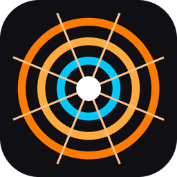
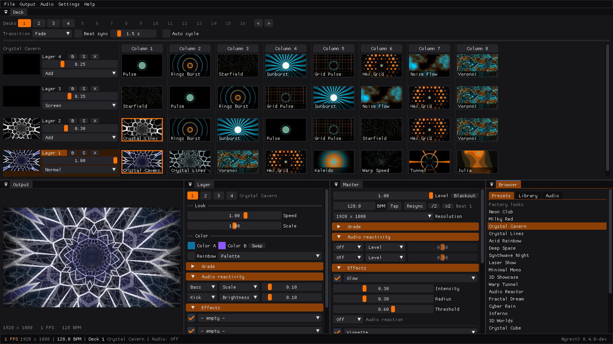
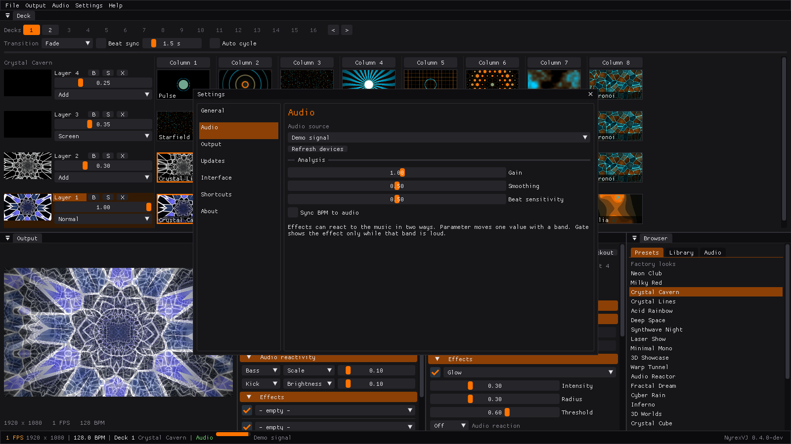
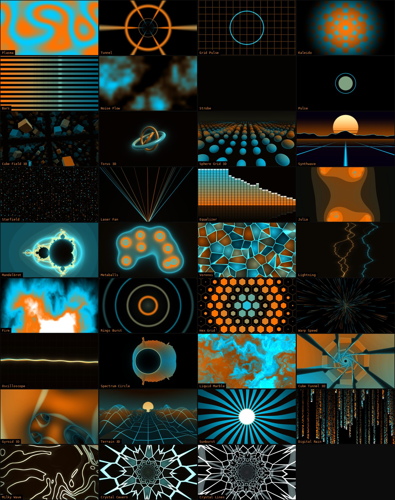
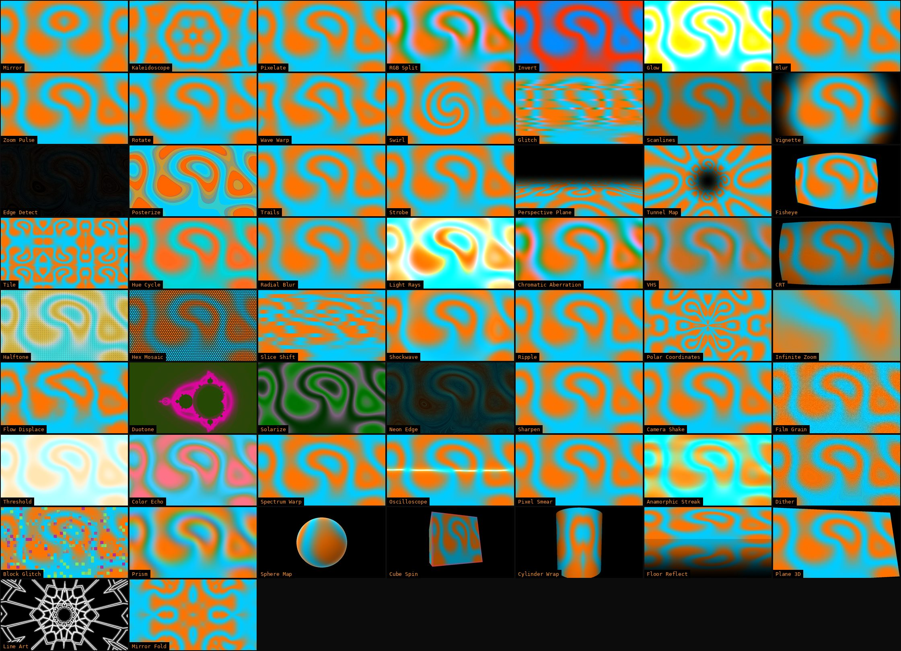

<p align="center">
  
</p>

<h1 align="center">NyrexVJ</h1>

<p align="center">
  Live visuals for VRChat events and parties. Native C++ and OpenGL, no game engine, one Windows executable.<br>
  <a href="README.de.md">Deutsch</a> · <a href="CHANGELOG.md">Changelog</a> · <a href="https://github.com/MarlonXDev/NyrexVJ/releases">Releases</a>
</p>

<p align="center">
  
</p>

NyrexVJ plays generative clips on layers, stacks effects on top, follows your music and sends the picture to OBS with Spout or to a fullscreen output window. It is built in the spirit of Resolume Arena, small enough to start in a second.

> Status: v0.4.0. Clips, effects, 16 decks with smooth transitions, presets, audio reactivity, Spout output, the output window, a settings window, English and German and the auto-updater work. Video clips and MIDI are not implemented yet.

## Download

Get `NyrexVJ.exe` from the [Releases page](https://github.com/MarlonXDev/NyrexVJ/releases). It is a single file, no installer needed. Windows SmartScreen may warn because the executable is not code-signed: choose "More info" and "Run anyway".

The release also contains `NyrexVJ-windows-x64.zip` (exe, changelogs, readmes) and `SHA256SUMS.txt`.

## Highlights

- **16 decks, smooth transitions.** Set up to 16 looks and glide between them with Fade, Dissolve, Zoom, Wipe, Radial, Spin or Slide, timed in seconds or beats, with an optional auto cycle.
- **Audio reactive.** Pick system audio (your DJ program), a microphone, a line-in or a demo signal. Layers, the master and every effect parameter can follow Bass, Mid, High, Level or Kick, and an effect can be set to Gate so it only shows while the music is loud.
- **OBS in two clicks.** Spout output with a sender name of your choice. In OBS add the source "Spout2 Capture" and select the sender.
- **35 clips, 58 effects, 18 presets.** Fractals, raymarched 3D scenes, contour-line fluids, crystal tunnels, lightning, fire, spectrum visuals and more.
- **Settings window.** One place for audio, output, Spout, updates, language and interface size, plus a status bar that shows FPS, tempo, deck and audio at a glance.
- **English and German.** English is the default, switch any time under Help, Language.
- **Welcome screen.** Shown on the first start and after every update, with everything that is new.
- **Self-updating.** Checks GitHub on start, verifies the SHA-256 sum and shows a small card at the top right with Restart now or Later.

<p align="center">
  
</p>

## Decks

The row above the clip grid holds 16 deck buttons. Each deck is a full set of four layers, eight columns, effects and colours. Click a button to switch, the new deck takes over with a transition instead of a cut. The current deck is orange, empty decks are dim and start blank when you click them.

| Transition | Look |
| --- | --- |
| Fade | Smooth crossfade |
| Dissolve | Noisy burn-through with a glowing edge |
| Zoom | Pulls through the old picture into the new one |
| Wipe | Soft diagonal wipe |
| Radial | Circle that opens from the centre |
| Spin | Both pictures rotate into each other |
| Slide | New deck pushes in from the side |

Set the length in seconds or tick Beat sync to count in beats, and tick Auto cycle to step through the used decks every 4 to 128 beats. Switching again in the middle of a transition freezes the picture you see and fades from there, so there is never a jump.

Right click a deck button to rename it, copy the current deck into it, fill it with a factory look, clear it or remove it. In the Presets tab a click on a factory look loads it into the current deck, and "Fill the decks with factory looks" puts 16 looks into the 16 decks. Decks are saved with the preset and with the session.

## Audio

Open the Audio tab in the Browser panel, or Settings, Audio.

| Source | What it listens to |
| --- | --- |
| Output devices (loopback) | Whatever your PC plays, for example Rekordbox, Serato, Spotify or a browser |
| Input devices | Microphone or line-in |
| Demo signal | A built-in beat so you can build looks without music |

The tab shows the live spectrum, Bass, Mid, High and Level meters, beat detection and a tempo estimate. Gain, smoothing and beat threshold are adjustable in Settings, Audio, and "Sync BPM to audio" locks the tempo to the detected beat. If the chosen device delivers no sound for a few seconds the tab and the status bar say so.

<p align="center">
  
</p>

Reactivity is set in three places:

- **Layer panel**: two modulation slots per layer (band to opacity, scale, speed, hue, brightness or saturation, with an amount).
- **Master panel**: the same for the final picture.
- **Every effect slot**: a band and a mode. In Parameter mode the band moves one effect value by an amount. In Gate mode the effect only shows while the band is loud and fades out in silence, the amount sets how sensitive it is.

Bars, Equalizer, Spectrum Circle, Oscilloscope, Spectrum Warp and the Oscilloscope effect draw the real spectrum or waveform. Without an audio source they run on a virtual beat that follows the BPM.

## Spout and OBS

1. In NyrexVJ tick "Send to OBS via Spout" in Settings, Output (or the Output menu) and choose a sender name.
2. In OBS install the [obs-spout2-plugin](https://github.com/Off-World-Live/obs-spout2-plugin) once.
3. Add a source "Spout2 Capture" and pick the sender from the list.

Spout is Windows only. The output window (F11) with OBS window capture keeps working as an alternative.

## Clips and effects

<p align="center">
  
</p>

Every layer has four effect slots, and so does the master.

<p align="center">
  
</p>

The effect gallery shows each effect with default settings on the Plasma clip (Duotone on Mandelbrot and Line Art on Crystal Cavern, because Plasma has almost no brightness contrast).

## Presets

18 factory looks: Neon Club, Milky Red, Crystal Cavern, Crystal Lines, Acid Rainbow, Deep Space, Synthwave Night, Laser Show, Minimal Mono, 3D Showcase, Warp Tunnel, Audio Reactor, Fractal Dream, Cyber Rain, Inferno, 3D Worlds, Crystal Cube and Pop Art. Save your own in the Presets tab, a saved preset contains all 16 decks. The last session is restored on start.

## Controls

| Input | Action |
| --- | --- |
| Click a cell | Play that clip on its layer |
| Click a column header, or keys 1 to 8 | Trigger the whole column |
| Space | Tap tempo |
| Page Up / Page Down | Previous / next used deck |
| Ctrl + 1 to 8, Ctrl + Shift + 1 to 8 | Deck 1 to 8, deck 9 to 16 |
| Ctrl + , | Open Settings |
| B | Blackout |
| F11 | Fullscreen output window |
| Esc | Leave fullscreen |
| Right-click a cell | Assign or clear a clip |
| Right-click a deck button | Rename, copy, fill, clear or remove the deck |
| Right-click a slider | Reset it to its default |
| Drag from Library to a cell | Assign a clip |
| B / S / X on a layer | Bypass / solo / stop the layer |

## Languages

English is the default. German is built in. Change it under Settings, General, under Help, Language or on the welcome screen, the choice is saved. Clip and effect names stay in English so they match what other VJ programs call them. A new language needs a translation table next to `src/core/i18n_de.cpp` and an entry in `src/core/i18n.cpp`.

## Auto-update

NyrexVJ checks GitHub on start (Settings, Updates). When a newer build exists it is downloaded and prepared in the background, and a card appears at the top right with Restart now and Later. Later shrinks the card to a slim badge that stays until you restart. Turn off "Download updates automatically" to get an Install button instead.

| Channel | Source | Updates when |
| --- | --- | --- |
| Latest build (default) | rolling `nightly` pre-release | every commit on `main` |
| Stable | latest GitHub Release | a new version tag is published |

The updater only works while the repository is public.

## Project layout

```
NyrexVJ/
├── src/
│   ├── app/        Dear ImGui interface: deck, panels, browser, settings window, status bar, update card, welcome screen, theme
│   ├── audio/      WASAPI capture and loopback, FFT analysis, beat and tempo detection
│   ├── core/       Composition model, presets, settings, i18n, log, SHA-256
│   ├── render/     OpenGL engine, clip and effect libraries, output window, Spout
│   ├── update/     Update check, installer, changelog parser
│   ├── platform/   Windows and fallback platform code
│   └── main.cpp
├── tests/          Unit tests for core, audio, i18n and update logic
├── scripts/        Repository checks (translation coverage)
├── resources/      Windows icon and resource template
├── docs/           Images used by this readme
├── third_party/    Vendored glad and nlohmann/json
└── .github/        CI, issue templates
```

## Build from source

Requirements: CMake 3.21 or newer, a C++20 compiler and a GPU with OpenGL 3.3.

Windows with Visual Studio:

```
cmake -S . -B build -A x64
cmake --build build --config Release
ctest --test-dir build -C Release
```

Linux needs the X11 development packages that GLFW requires (Xrandr, Xinerama, Xcursor, Xi):

```
cmake -S . -B build -G Ninja
cmake --build build
ctest --test-dir build
```

GLFW, Dear ImGui and Spout2 (Windows) are downloaded by CMake during configuration. Audio capture and Spout are Windows only, on other systems the audio demo signal is used.

## Tests

```
ctest --test-dir build
python scripts/check_i18n.py
NyrexVJ --check-shaders
```

`check_i18n.py` makes sure every UI string has a German translation. `--check-shaders` compiles every clip and effect and exits with code 1 on any failure. CI runs all of it on every push.

## Releasing

1. Bump the version in `CMakeLists.txt` (`project(NyrexVJ VERSION x.y.z)`) and add a section to `CHANGELOG.md` and `CHANGELOG.de.md`.
2. Commit, then tag and push: `git tag vx.y.z && git push origin vx.y.z`.
3. GitHub Actions builds, tests and publishes the Release with `NyrexVJ.exe`, the zip and `SHA256SUMS.txt`. The release text comes from the matching `CHANGELOG.md` section.

Every push to `main` also refreshes the `nightly` pre-release that the default update channel follows.

## Command line

| Option | Effect |
| --- | --- |
| `--preset NAME` | Load a factory or user preset on start |
| `--column N` | Trigger column N (1-based) on start |
| `--clip NAME` | Start with an empty deck that plays only this clip |
| `--effect NAME` | Put an effect in the first master effect slot |
| `--select-layer N` | Select layer N (1-based) |
| `--resolution IDX` | Output resolution index |
| `--tab IDX` | Browser tab to show (0 Presets, 1 Library, 2 Audio) |
| `--settings IDX` | Open the settings window on page IDX (0 to 6) |
| `--decks A,B,C` | Fill decks 1, 2, 3 with these factory looks |
| `--transition NAME` | Transition type for deck changes |
| `--transition-seconds S` | Transition length in seconds |
| `--switch-deck FRAME:DECK` | With `--frames`, switch to deck DECK (1-based) at that frame |
| `--dump-at FRAME:FILE.png` | With `--frames`, save the engine output at that frame |
| `--demo-update STATE` | Show the update card as `available`, `downloading`, `ready` or `later` |
| `--output` | Open the output window on start |
| `--lang en\|de` | Start in this language |
| `--audio-demo` | Use the demo audio signal |
| `--welcome` / `--no-welcome` | Force or skip the welcome screen |
| `--fresh` | Ignore the saved session |
| `--no-update-check` | Skip the update check |
| `--check-shaders` | Compile every shader and exit |
| `--frames N` | Run N frames at a fixed 60 FPS step, then exit |
| `--screenshot FILE.png` | With `--frames`, save the window as PNG |
| `--dump-output FILE.png` | With `--frames`, save the engine output as PNG |

User data lives in `%APPDATA%\NyrexVJ` on Windows and `~/.config/NyrexVJ` on Linux: log, window layout, settings, autosave and `presets/`. Set `NYREXVJ_DATA_DIR` to use another folder.

## Roadmap

- Video clips (H.264 and HAP) through FFmpeg
- MIDI controller mapping
- OSC input
- DMX strip output for VRSL
- Custom shader clips loaded from files
- More languages

## Third-party software

- [GLFW](https://www.glfw.org/) (zlib license)
- [Dear ImGui](https://github.com/ocornut/imgui) (MIT)
- [Spout2](https://github.com/leadedge/Spout2) (BSD 2-Clause), Windows only
- [glad](https://github.com/Dav1dde/glad) generated OpenGL loader (WTFPL or CC0, plus Apache-2.0 for the Khronos parts)
- [stb_image_write](https://github.com/nothings/stb) (public domain or MIT)
- [nlohmann/json](https://github.com/nlohmann/json) (MIT)

## License

MIT, see [LICENSE](LICENSE).
